# CKAD Exam Preparation Notes

Condensed concepts from a Udemy CKAD course, for quick review before the exam.

## Table of Contents
1. [Kubernetes Basic Concepts (Nodes, Cluster, Master, Components)](#1-kubernetes-basic-concepts)
2. [Docker vs containerd (Container Runtimes & CLI Tools)](#2-docker-vs-containerd)
3. [Pods — Basic Concepts](#3-pods--basic-concepts)
4. [Pods — YAML Definition Files](#4-pods--yaml-definition-files)
5. [Replication Controllers & ReplicaSets](#5-replication-controllers--replicasets)
6. [Deployments](#6-deployments)
7. [Namespaces](#7-namespaces)
8. [Services — NodePort](#8-services--nodeport)
9. [Services — ClusterIP](#9-services--clusterip)
10. [Imperative Commands (Exam Tip)](#10-imperative-commands-exam-tip)
11. [kubectl explain & api-resources](#11-kubectl-explain--api-resources)
12. [Docker Images & Dockerfile](#12-docker-images--dockerfile)
13. [Docker Commands, Arguments & Entrypoint](#13-docker-commands-arguments--entrypoint)
14. [Pod Commands & Arguments](#14-pod-commands--arguments)
15. [Environment Variables in Pods](#15-environment-variables-in-pods)
16. [ConfigMaps](#16-configmaps)
17. [Secrets](#17-secrets)
18. [Encrypting Secret Data at Rest (etcd)](#18-encrypting-secret-data-at-rest-etcd)
19. [Docker Security Basics](#19-docker-security-basics)
20. [Kubernetes Security Context](#20-kubernetes-security-context)
21. [Resource Requirements — Requests, Limits & Quotas](#21-resource-requirements--requests-limits--quotas)
22. [Service Accounts](#22-service-accounts)
23. [Taints & Tolerations](#23-taints--tolerations)
24. [Node Selectors](#24-node-selectors)
25. [Node Affinity](#25-node-affinity)
26. [Taints/Tolerations + Node Affinity Combined](#26-taintstolerations--node-affinity-combined)
27. [Multi-Container Pods](#27-multi-container-pods)
28. [Observability — Readiness Probes](#28-observability--readiness-probes)
29. [Observability — Liveness Probes](#29-observability--liveness-probes)
30. [Observability — Logging](#30-observability--logging)
31. [Observability — Monitoring](#31-observability--monitoring)
32. [Labels, Selectors & Annotations](#32-labels-selectors--annotations)
33. [Deployments — Updates, Rollouts & Rollbacks](#33-deployments--updates-rollouts--rollbacks)
34. [Additional Deployment Strategies](#34-additional-deployment-strategies)
35. [Jobs](#35-jobs)
36. [CronJobs](#36-cronjobs)
37. [Network Policies](#37-network-policies)
38. [Ingress](#38-ingress)
39. [Docker Storage: Layers, Volumes & Drivers](#39-docker-storage-layers-volumes--drivers)

---

## 1. Kubernetes Basic Concepts

**Node**
- A physical or virtual machine with Kubernetes installed.
- A *worker* machine where containers are actually launched.
- Formerly called a **minion**.

**Cluster**
- A set of nodes grouped together.
- Provides fault tolerance (if one node fails, app stays accessible on others) and load sharing.

**Master**
- A node configured to manage the cluster.
- Watches over worker nodes and orchestrates containers across them.

### Core Components (installed with Kubernetes)

| Component | Role |
|---|---|
| **kube-apiserver** | Frontend for Kubernetes; all interactions (CLI, UI, tools) go through it |
| **etcd** | Distributed, reliable key-value store holding all cluster data; also handles locking to avoid conflicts between multiple masters |
| **kubelet** | Agent on each worker node; ensures containers are running as expected |
| **Container runtime** | Software that runs containers (e.g. Docker, rkt, CRI-O) |
| **Controller** | "Brain" of orchestration — detects nodes/containers/endpoints going down and decides on remediation |
| **Scheduler** | Distributes/assigns newly created containers to nodes |

### Master vs Worker Node — Component Distribution

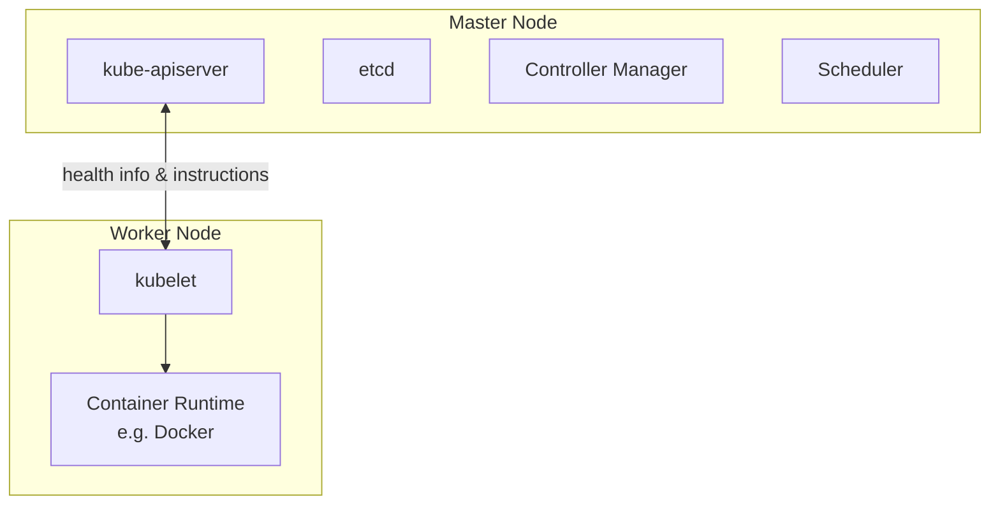

- **Master** = has the `kube-apiserver` (this is what defines it as master), plus etcd, controller manager, scheduler.
- **Worker/Minion** = has `kubelet`, which talks to the master (reports health, executes actions) + container runtime to actually run containers.

### kubectl (Kube Control CLI)
Used to deploy/manage applications and inspect the cluster.

| Command | Purpose |
|---|---|
| `kubectl run` | Deploy an application on the cluster |
| `kubectl cluster-info` | View cluster information |
| `kubectl get nodes` | List all nodes in the cluster |

---

## 2. Docker vs containerd

### History / Timeline

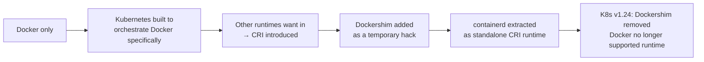

- **CRI (Container Runtime Interface)**: standard interface letting any compliant runtime plug into Kubernetes.
- **OCI (Open Container Initiative)**: defines the standards CRI relies on:
  - **Image spec** – how an image should be built.
  - **Runtime spec** – how a container runtime should behave.
- Docker predates CRI, so it never natively implemented it → Kubernetes used **Dockershim** as a bridge.
- **containerd** = the container-runtime piece inside Docker (daemon that manages `runc`), spun out as its own CRI-compliant, CNCF-graduated project. Can be installed independently of Docker.
- **Docker images still work** post-Dockershim removal, because they follow the OCI image spec — only the *runtime* (Docker Engine) was dropped, not image compatibility.

### CLI Tools Comparison

| Tool | From | Works with | Purpose | Production use? |
|---|---|---|---|---|
| `docker` | Docker | Docker Engine | Full-featured CLI (build, run, volumes, network, security) | ✅ (when Docker present) |
| `ctr` | containerd community | containerd only | Debugging containerd; very limited features | ❌ Debugging only |
| `nerdctl` | containerd community | containerd only | Docker-like CLI for containerd; general purpose, supports more features than Docker (lazy pulling, encrypted images, P2P distribution, image signing, namespaces) | ✅ Recommended replacement for `docker` |
| `crictl` | Kubernetes community | Any CRI-compatible runtime (containerd, CRI-O, etc.) | Inspect/debug containers & **pods** from Kubernetes' perspective | ❌ Debugging only |

### Key Command Equivalents

| Action | Docker | nerdctl | crictl |
|---|---|---|---|
| Run container | `docker run` | `nerdctl run` | ⚠️ possible but not recommended |
| List containers | `docker ps` | `nerdctl ps` | `crictl ps` |
| Pull image | `docker pull` | `nerdctl pull` | `crictl pull` (via `ctr images pull` too) |
| Exec into container | `docker exec -it <id> <cmd>` | `nerdctl exec -it` | `crictl exec -i -t <id> <cmd>` |
| View logs | `docker logs` | `nerdctl logs` | `crictl logs` |
| List pods | N/A (Docker unaware of pods) | N/A | `crictl pods` ✅ unique |

> ⚠️ **Don't create containers with `crictl`/`ctr` in a running cluster** — kubelet doesn't know about them and will delete them, since they're outside its managed state.

### Endpoint Resolution (crictl)
Default connection attempt order: **dockershim → containerd → CRI-O → docker.sock**

Override with:
- `crictl --runtime-endpoint <endpoint>`, or
- Environment variable `CONTAINER_RUNTIME_ENDPOINT`

### Practical Takeaway
- Old labs/docs → `docker` commands.
- Modern clusters (containerd-based) → use `crictl` for troubleshooting/debugging on nodes, `nerdctl` if you need a general-purpose Docker-like CLI.

> 📌 **Note: "Docker deprecation" ≠ Docker disappearing.** Only Docker-*as-Kubernetes-runtime* was deprecated (K8s no longer needs Docker's CLI/API/build tools since containerd handles the CRI side). Docker itself is still widely used for local dev/builds. Course examples may still use `docker` commands for teaching purposes — if you only have containerd, substitute `nerdctl` in place of `docker` in most cases.

---

## 3. Pods — Basic Concepts

- Kubernetes does **not** deploy containers directly on worker nodes — containers are encapsulated inside a **Pod**.
- A **Pod** = smallest deployable object in Kubernetes = (usually) a single instance of an application.

### Pods & Scaling

- Relationship between pods and containers is typically **1:1**.
- To scale **up**: create **new pods** (not new containers inside an existing pod).
- To scale **down**: delete existing pods.
- If a node runs out of capacity, add a **new node** and schedule additional pods there.

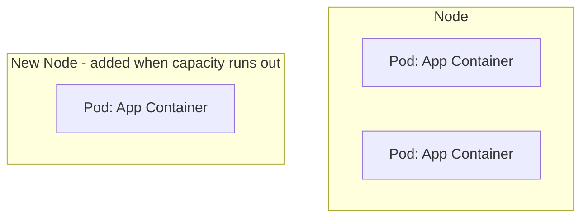

### Multi-Container Pods

- A pod *can* contain multiple containers, but usually **not multiple copies of the same container** (that's what extra pods are for).
- Valid use case: a **helper/sidecar container** supporting the main app (e.g. processing uploaded files, fetching data).

Containers in the same pod share:
| Shared resource | Detail |
|---|---|
| **Network namespace** | Can talk to each other via `localhost` |
| **Storage/volumes** | Can share the same volume space |
| **Lifecycle ("fate")** | Created together, destroyed together |

- Kubernetes automates what you'd otherwise do manually with plain Docker: linking containers, custom networks, shared volumes, and monitoring/restarting dependent containers.
- ⚠️ **Multi-container pods are a rare use case** — course (and most real-world basic setups) sticks to **single container per pod**.

### Deploying & Inspecting Pods

| Command | Purpose |
|---|---|
| `kubectl run <name> --image=<image>` | Creates a pod and deploys a container from the given image (pulled from Docker Hub by default, or a private repo if configured) |
| `kubectl get pods` | Lists pods and their status (e.g. `ContainerCreating` → `Running`) |

- At this stage (just a pod, no Service yet), the app is only accessible **internally from the node** — external access requires Services/networking (covered later).

---

## 4. Pods — YAML Definition Files

Every Kubernetes definition file has **4 required top-level fields**:

| Field | Type | Purpose |
|---|---|---|
| `apiVersion` | string | API version used to create the object (e.g. `v1` for pods; others: `apps/v1`, `extensions/v1beta1`) |
| `kind` | string | Type of object (`Pod`, `ReplicaSet`, `Deployment`, `Service`, ...) |
| `metadata` | dictionary | Data *about* the object: `name`, `labels` (only fields Kubernetes expects — can't add arbitrary keys here) |
| `spec` | dictionary | Object-specific configuration (structure differs per `kind` — check docs) |

### YAML Structure Rules (as applied to K8s)
- `metadata.name` → string; `metadata.labels` → a nested dictionary of **arbitrary** key-value pairs (unlike `metadata` itself).
- Siblings (e.g. `name` and `labels`) must have **equal indentation**, and **more indentation than their parent** (`metadata`).
- Labels are useful for grouping/filtering objects later (e.g. `app: front-end`, `app: back-end`, `app: database`) once you have many pods.

### Pod Spec Example

```yaml
apiVersion: v1
kind: Pod
metadata:
  name: myapp-pod
  labels:
    type: front-end
    app: myapp
spec:
  containers:
    - name: nginx-container
      image: nginx
      ports:
        - containerPort: 8080
```

- `spec.containers` is a **list** (pods can hold multiple containers) — each `-` denotes a list item.
- Each list item is a dictionary with (at least) `name` and `image`.
- `ports` (optional) declares the port(s) the container listens on — informational/documentation purposes; it doesn't by itself expose the port outside the pod (that's what a Service is for).

### Commands

| Command | Purpose |
|---|---|
| `kubectl create -f pod-definition.yaml` | Create object(s) from a YAML file |
| `kubectl get pods` | List pods |
| `kubectl get pods -o wide` | List pods with extra details (Node, IP, etc.) |
| `kubectl describe pod <name>` | Detailed info: creation time, labels, containers, associated events |
| `kubectl delete deployment <name>` | Remove a deployment (e.g. cleanup before creating a fresh pod) |

> 💡 **Editor tip**: An IDE with YAML support (e.g. PyCharm, VS Code) shows the document as a tree structure, which helps confirm indentation/hierarchy is correct — useful for catching sibling vs. child mistakes (e.g. `name`/`labels` both under `metadata`). Multiple items under `containers:` show as "item 1 of N", "item 2 of N", confirming it's parsed as a list.

### ✏️ Editing Existing Pods (exam tip)

- **If given a pod definition file**: edit the file, delete the old pod, recreate it (`kubectl delete pod <name>` → `kubectl create -f <file>`).
- **If not given a file**, extract it first:
  ```bash
  kubectl get pod <pod-name> -o yaml > pod-definition.yaml
  ```
  Then edit → delete → recreate.
- **`kubectl edit pod <pod-name>`** opens the live definition in an editor and applies changes directly — but **only these fields are editable in-place**:
  - `spec.containers[*].image`
  - `spec.initContainers[*].image`
  - `spec.activeDeadlineSeconds`
  - `spec.tolerations`
  - `spec.terminationGracePeriodSeconds`
- Anything else (e.g. changing the container's `name`, adding a container, changing ports) → **must delete & recreate** the pod, since pods are largely immutable.

**What actually happens if you try to `kubectl edit` a non-editable field:**
1. `kubectl edit pod <name>` opens the spec in vi.
2. You edit a non-editable field (e.g. env vars, resources, service account) and save → **save is denied**.
3. Kubernetes still writes your edited version to a **temporary file** (e.g. `/tmp/kubectl-edit-ccvrq.yaml`) — the path is shown in the error message.
4. Delete the running pod: `kubectl delete pod <name>`
5. Create a new one from that temp file: `kubectl create -f /tmp/kubectl-edit-ccvrq.yaml`

> Both this "edit → denied → use temp file" flow and the manual "get -o yaml → edit → delete → recreate" flow achieve the same result — use whichever's more convenient.

**One-step shortcut**: `kubectl replace --force -f <file>` deletes the pod and recreates it from the file in a single command.
- `kubectl replace` has **no `--now` flag** (that one belongs to `kubectl delete`). To shorten the wait, use `--grace-period=1` (what `--now` means for `delete`). `--grace-period=0` is only allowed together with `--force`, and skips the graceful shutdown, so keep it for labs.
- Or do it in two steps: `kubectl delete pod <name> --now`, then `kubectl create -f <file>`.

### ✏️ Editing Deployments (much easier!)
- A **Deployment** owns a pod *template*, so editing **any** field of the pod spec is allowed.
- `kubectl edit deployment <name>` — the Deployment controller automatically deletes the old pod(s) and creates new ones matching the updated template.
- No manual delete/recreate dance needed — this is one advantage of managing pods via Deployments rather than bare pods.

---

## 5. Replication Controllers & ReplicaSets

### Why replication?
- **High availability**: if a pod crashes, a replacement is automatically created.
- **Load sharing**: multiple pods share user load; can scale across multiple nodes.
- Works even for a **single desired replica** — it still auto-recreates a failed pod.

### ReplicationController (RC) vs ReplicaSet (RS)

| | ReplicationController | ReplicaSet |
|---|---|---|
| Status | Older, legacy | Newer, **recommended** |
| `apiVersion` | `v1` | `apps/v1` |
| `selector` required? | No (defaults to pod template's labels if omitted) | **Yes** — must be explicitly defined (`matchLabels`) |
| Can manage pre-existing pods (not created by it) | Limited | Yes, via label selector matching |
| Selector matching options | Basic | More powerful (supports `matchExpressions`, etc.) |

> ⚠️ Using `v1` instead of `apps/v1` for a ReplicaSet gives: `no matches for kind "ReplicaSet"`.

### Definition File Structure

Both RC and RS nest a **pod template** inside `spec`. Structure = parent object wrapping a pod definition:

#### ReplicationController example

```yaml
apiVersion: v1
kind: ReplicationController
metadata:
  name: myapp-rc
  labels:
    app: myapp
    type: front-end
spec:
  replicas: 3
  template:
    # All Pod's metadata and spec go here
    metadata:
      labels:
        app: myapp
        type: front-end
    spec:
      containers:
        - name: nginx-container
          image: nginx
```

#### ReplicaSet example

```yaml
apiVersion: apps/v1
kind: ReplicaSet
metadata:
  name: myapp-replicaset
  labels:
    app: myapp
    type: front-end
spec:
  replicas: 3
  selector:
    matchLabels:
      type: front-end
  template:
    # All Pod's metadata and spec go here
    metadata:
      labels:
        app: myapp
        type: front-end
    spec:
      containers:
        - name: nginx-container
          image: nginx
```

### Side-by-side diff

| | ReplicationController | ReplicaSet |
|---|---|---|
| `apiVersion` | `v1` | `apps/v1` |
| `kind` | `ReplicationController` | `ReplicaSet` |
| `spec.replicas` | ✅ | ✅ |
| `spec.selector` | ❌ not required (defaults to matching `template.metadata.labels`) | ✅ **required**, written as `matchLabels` |
| `spec.template` | ✅ | ✅ |

The only structural differences are: **`apiVersion`**, **`kind`**, and the **mandatory `selector`** block in ReplicaSet. Everything else (`metadata`, `spec.replicas`, `spec.template`) is written identically.

- `spec.template` = pod definition **minus** its own `apiVersion`/`kind` (those two lines are dropped; everything else nests under `template`).
- `spec.replicas` and `spec.template` (and `spec.selector` for RS) are **siblings** — same indentation level under `spec`.
- `selector.matchLabels` **must match** the labels in `template.metadata.labels` (and/or on any existing pods you want the RS to adopt).

### Labels & Selectors — Why They Matter
- ReplicaSet is a **monitoring process**: it watches for pods matching its selector and ensures the desired count is met.
- It can **adopt pre-existing pods** that match the selector (won't create duplicates if enough already exist) — but the `template` is still required, since it's needed if a replacement pod must be created later.

### Commands

| Command | Purpose |
|---|---|
| `kubectl create -f rc-definition.yaml` | Create RC or RS from file |
| `kubectl get replicationcontroller` | List RCs |
| `kubectl get replicaset` (or `rs`) | List RSs |
| `kubectl get pods` | Pods created show a name prefixed by the RC/RS name |
| `kubectl delete replicaset <name>` | Delete RS (also deletes its pods) |
| `kubectl replace -f <file>` | Replace/update object from file |
| `kubectl apply -f <file>` | Apply updated definition file (e.g. after editing `replicas` count) |
| `kubectl scale --replicas=6 -f <file>` | Scale via CLI using file reference |
| `kubectl scale --replicas=6 replicaset <name>` | Scale via CLI using type/name (doesn't update the YAML file) |

> 📌 Scaling via `kubectl scale` does **not** update the replica count inside the definition file — the file and live cluster state can drift out of sync.

---

## 6. Deployments

### Kubernetes Object Hierarchy

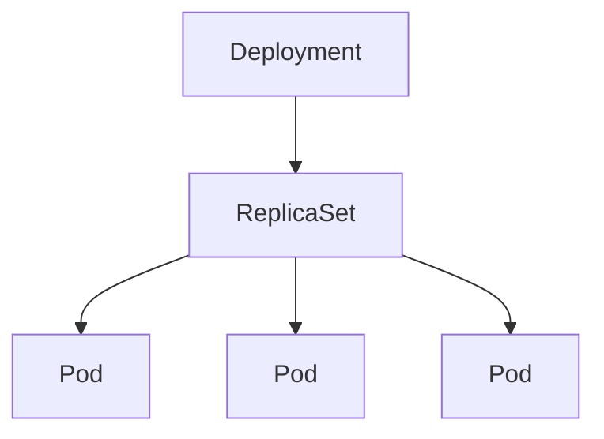

- **Pod** → single instance of an application.
- **ReplicaSet** → ensures N pods are running.
- **Deployment** → sits above ReplicaSet; provides production-grade capabilities:
  - **Rolling updates** — upgrade instances one at a time (not all at once), avoiding user impact.
  - **Rollback** — undo a problematic update.
  - **Pause & Resume** — batch multiple changes (e.g. image upgrade + scaling + resource limits) and apply them together as one rollout instead of one-by-one.

### Definition File

Nearly identical to a ReplicaSet definition — only `kind` differs:

```yaml
apiVersion: apps/v1
kind: Deployment
metadata:
  name: myapp-deployment
  labels:
    app: myapp
    type: front-end
spec:
  replicas: 3
  selector:
    matchLabels:
      type: front-end
  template:
    metadata:
      labels:
        app: myapp
        type: front-end
    spec:
      containers:
        - name: nginx-container
          image: nginx
```

### What Happens on Creation
`kubectl create -f deployment-definition.yaml` →
1. Creates a **Deployment**
2. Which automatically creates a **ReplicaSet** (named after the deployment)
3. Which automatically creates **Pods** (named after the deployment + replica set)

### Commands

| Command | Purpose |
|---|---|
| `kubectl create -f deployment-definition.yaml` | Create a deployment |
| `kubectl get deployments` | List deployments |
| `kubectl get replicaset` | See the auto-created ReplicaSet |
| `kubectl get pods` | See the auto-created Pods |
| `kubectl get all` | See all created objects (Deployment → ReplicaSet → Pods) at once |

> At this stage, Deployment behaves just like a ReplicaSet — the real value (rolling updates, rollback, pause/resume) is covered in [Section 33](#33-deployments--updates-rollouts--rollbacks).

---

## 7. Namespaces

**Analogy**: Two people named "Mark" in different houses (Smiths, Williams) go by first name *within* their house, but need the full name (Mark Smith) when referenced from outside or across houses. Houses = namespaces; each has its own rules and resources.

### Default Namespaces (auto-created by Kubernetes)

| Namespace | Purpose |
|---|---|
| `default` | Where your objects go if you don't specify a namespace |
| `kube-system` | Internal Kubernetes pods/services (networking, DNS, etc.) — isolated to avoid accidental changes |
| `kube-public` | Resources meant to be accessible to **all** users across all namespaces |

### Why Use Namespaces
- Isolate resources between environments (e.g. `dev` vs `prod`) on the **same cluster**.
- Prevent accidental cross-environment changes.
- Apply namespace-specific **policies** and **resource quotas** (limit CPU/memory/pod count per namespace).

### Cross-Namespace Communication (DNS)

- Within the **same** namespace: reference a service simply by its name → `db-service`
- Across namespaces: `<service-name>.<namespace>.svc.cluster.local`
  - e.g. `db-service.dev.svc.cluster.local`

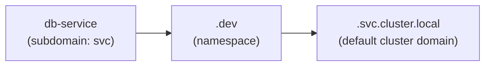
Breakdown: `<service>.<namespace>.svc.cluster.local` — `cluster.local` = default cluster domain, `svc` = subdomain for services.

### Commands

| Command | Purpose |
|---|---|
| `kubectl get pods` | Lists pods in `default` namespace only |
| `kubectl get pods --namespace=kube-system` | List pods in a specific namespace |
| `kubectl create -f pod-definition.yaml --namespace=dev` | Create a pod in a specific namespace (CLI override) |
| `kubectl create namespace dev` | Create a namespace directly via CLI |
| `kubectl get pods --all-namespaces` (or `-A`) | List pods across **all** namespaces |
| `kubectl config current-context` | Show which context is currently active |
| `kubectl config set-context --current --namespace=dev` | Same as above, using `--current` instead of naming the context explicitly |
| `kubectl config set-context --current -n dev` | Same as above, using the short flag `-n` (note: no `=` with short flags) |
| `kubectl config set-context $(kubectl config current-context) --namespace=dev` | Permanently switch the **current context** to a namespace (no need to pass `--namespace` each time) |
| `kubectl config get-contexts` | List all contexts and see which one is currently active |

To permanently bind a pod to a namespace in its YAML (instead of passing `--namespace` every time):
```yaml
apiVersion: v1
kind: Pod
metadata:
  name: myapp-pod
  namespace: dev
  labels:
    app: myapp
spec:
  containers:
    - name: nginx-container
      image: nginx
```

### Creating a Namespace via Definition File

```yaml
apiVersion: v1
kind: Namespace
metadata:
  name: dev
```
`kubectl create -f namespace-dev.yaml`

### Resource Quotas (limit usage per namespace)

```yaml
apiVersion: v1
kind: ResourceQuota
metadata:
  name: compute-quota
  namespace: dev
spec:
  hard:
    pods: "10"
    requests.cpu: "4"
    requests.memory: 5Gi
    limits.cpu: "10"
    limits.memory: 10Gi
```

> 📌 Contexts (used to manage multiple clusters/environments from one `kubectl` setup) are a related but separate topic — covered elsewhere.

---

## 8. Services — NodePort

### Purpose
A **Service** enables communication between pods, and between pods and the outside world (loose coupling between microservices). It's a Kubernetes object like Pods/ReplicaSets/Deployments.

### The Networking Problem
- Each **node** has its own IP (e.g. `192.168.1.2`), on the same network as your laptop.
- Each **pod** has an IP in a separate internal pod network (e.g. `10.244.0.2`) — **not directly reachable** from outside the cluster/node.
- SSH-ing into the node and curling the pod IP works, but isn't practical for external users.
- **Solution**: a **Service** sits in the middle and forwards traffic from an externally-reachable node port → to the pod.

### Service Types

| Type | Behavior |
|---|---|
| **NodePort** | Exposes the service on a static port on every node's IP; external traffic → node port → service → pod |
| **ClusterIP** | Creates a virtual internal IP for service-to-service communication (e.g. front-end → back-end) — default type |
| **LoadBalancer** | Provisions an external load balancer (on supported cloud providers) — e.g. to distribute traffic across front-end web servers |

### NodePort — Three Ports Involved

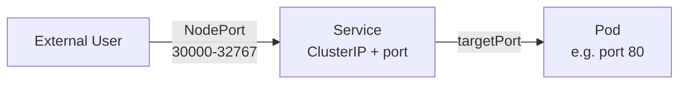

| Port | Meaning | Constraint |
|---|---|---|
| `targetPort` | Port the app/container listens on inside the pod | Defaults to `port` if omitted |
| `port` | Port on the Service itself (its virtual IP) | **Only mandatory field** |
| `nodePort` | Port exposed on the node's IP for external access | Valid range: **30000–32767**; auto-assigned from that range if omitted |

### Definition File

```yaml
apiVersion: v1
kind: Service
metadata:
  name: myapp-service
spec:
  type: NodePort
  ports:
    - targetPort: 80
      port: 80
      nodePort: 30008    # Range 30000-32767
  selector:
    # Put metadata.labels of Pod here
    app: myapp
    type: front-end
```

- `spec.ports` is a **list** (a service can expose multiple port mappings).
- `spec.selector` links the service to pod(s) — must **match the labels** on the target pod(s) (same labels/selector mechanism as ReplicaSets/Deployments). Without this, the Service has no way to know which pods to forward to.

### Commands

| Command | Purpose |
|---|---|
| `kubectl create -f service-definition.yaml` | Create the service |
| `kubectl get services` (or `svc`) | List services, their ClusterIP, and mapped ports |
| `curl http://<node-ip>:<nodePort>` | Access the app externally |

### Multi-Pod & Multi-Node Behavior (automatic — no extra config needed)

- **Multiple pods, same node**: if several pods share the label matched by the selector, the Service automatically load-balances across all of them using a **random algorithm** (built-in load balancing).
- **Multiple pods across multiple nodes**: Kubernetes automatically maps the **same nodePort** on **every node** in the cluster — so the app is reachable via *any* node's IP + that port, regardless of which node actually hosts the pod.
- Service endpoints update automatically as pods are added/removed (no manual reconfiguration needed).

---

## 9. Services — ClusterIP

### The Problem
A full-stack app typically has multiple tiers: front-end, back-end, cache (Redis), database (MySQL). These tiers need to talk to each other, but:
- Pod IPs are **ephemeral** — pods die/restart, IPs change constantly.
- With multiple pods per tier, **which one** should another pod connect to, and who decides?

### The Solution: ClusterIP
A **ClusterIP** service groups a set of pods (e.g. all backend pods) and exposes **one stable internal IP + DNS name** as the single access point. Requests to the service are forwarded to one of the grouped pods (**randomly**).

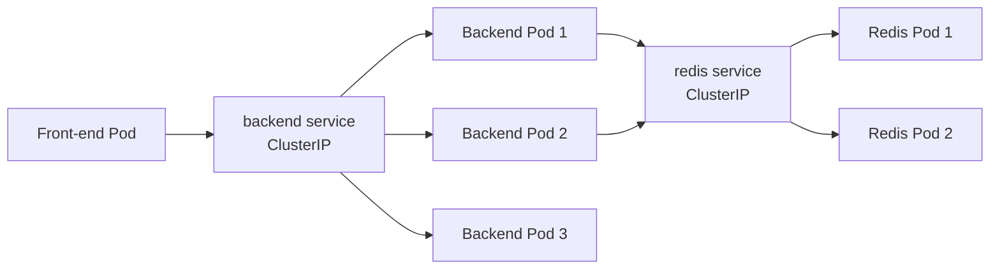

- Enables clean microservices architecture: each tier can scale, move, or be replaced without breaking communication — other pods only ever talk to the **service name**, never pod IPs directly.
- **ClusterIP is the default service type** — if `type` is omitted, it defaults to ClusterIP.

### Definition File

```yaml
apiVersion: v1
kind: Service
metadata:
  name: back-end
spec:
  type: ClusterIP     # default type, can be omitted
  ports:
    - targetPort: 80
      port: 80
  selector:
    # Put metadata.labels of Pod here
    app: myapp
    type: back-end
```

- `targetPort` = port the backend pods expose; `port` = port on the service itself.
- `selector` links the service to pods, same pattern as NodePort — copy the labels from the target pod definition.

### Commands

| Command | Purpose |
|---|---|
| `kubectl create -f service-definition.yaml` | Create the service |
| `kubectl get services` (or `svc`) | Check status, ClusterIP, ports |

- Other pods reach it via the **service name** (DNS) or its **ClusterIP** — never via individual pod IPs.

---

## 10. Imperative Commands (Exam Tip)

Declarative (YAML files) is the standard approach, but **imperative commands save major time** on the exam — both for quick one-off tasks and for generating a YAML template to then edit.

### Key Flags

| Flag | Purpose |
|---|---|
| `--dry-run=client` | Doesn't actually create the resource — just validates the command |
| `-o yaml` | Outputs the resource definition as YAML instead of creating it |
| Combined + `>` redirect | Generates a YAML file to edit, instead of writing one from scratch |

```bash
kubectl run nginx --image=nginx --dry-run=client -o yaml > nginx-pod.yaml
```

### Pod

| Task | Command |
|---|---|
| Create an nginx pod | `kubectl run nginx --image=nginx` |
| Generate pod YAML only (no creation) | `kubectl run nginx --image=nginx --dry-run=client -o yaml` |

### Deployment

| Task | Command |
|---|---|
| Create a deployment | `kubectl create deployment nginx --image=nginx` |
| Generate deployment YAML only | `kubectl create deployment nginx --image=nginx --dry-run=client -o yaml` |
| Create with 4 replicas directly | `kubectl create deployment nginx --image=nginx --replicas=4` |
| Scale an existing deployment | `kubectl scale deployment nginx --replicas=4` |
| Generate YAML to file, then edit before creating | `kubectl create deployment nginx --image=nginx --dry-run=client -o yaml > nginx-deployment.yaml` |

### Service

**ClusterIP** — expose pod `redis` on port 6379 as `redis-service`:
```bash
kubectl expose pod redis --port=6379 --name redis-service --dry-run=client -o yaml
```
- ✅ Automatically uses the **pod's actual labels** as selectors.

Alternative:
```bash
kubectl create service clusterip redis --tcp=6379:6379 --dry-run=client -o yaml
```
- ⚠️ Does **not** use the pod's labels — assumes selector `app=redis` and you **cannot pass in custom selectors** via CLI. Only safe if your pod's label happens to match; otherwise generate the file and edit the selector manually.

**NodePort** — expose pod `nginx` port 80 as `nginx-service`, nodePort 30080:
```bash
kubectl expose pod nginx --port=80 --name nginx-service --type=NodePort --dry-run=client -o yaml
```
- ✅ Uses pod's labels as selectors, but ⚠️ **cannot specify the nodePort** via this command — must generate the file and manually add `nodePort: 30080` before creating.

Alternative:
```bash
kubectl create service nodeport nginx --tcp=80:80 --node-port=30080 --dry-run=client -o yaml
```
- ✅ Can specify nodePort, but ⚠️ does **not** use the pod's labels as selectors.

> 💡 **Recommendation**: prefer `kubectl expose` (keeps correct selectors). If you need a specific `nodePort`, generate the YAML with `expose` + `--dry-run=client -o yaml`, then manually add the `nodePort` field before applying.

### Output Formatting (`-o`)

```
kubectl [command] [TYPE] [NAME] -o <output_format>
```

| Format | Result |
|---|---|
| `-o json` | Full resource as JSON |
| `-o yaml` | Full resource as YAML |
| `-o name` | Just the resource name |
| `-o wide` | Plain-text table + extra columns (e.g. IP, Node) |

```bash
kubectl get pods -o wide
# NAME      READY   STATUS    RESTARTS   AGE     IP          NODE     ...
```

> Combine with `--dry-run=client` to preview a resource's YAML/JSON without creating it (see examples above).

---

## 11. kubectl explain & api-resources ⭐

Useful for exploring resources and fields **without leaving the terminal / docs**.

| Command | Purpose |
|---|---|
| `kubectl api-resources` | List **all** resource types: their name, short name, API group/version, whether namespaced. Great when you forget a resource's exact name, short name, or correct casing |
| `kubectl explain pod` | Shows **top-level** fields of a resource (`apiVersion`, `kind`, `metadata`, `spec`, `status`) with type + description |
| `kubectl explain pod.spec` | Drills into a specific field's **subfields** (still only one level deep at a time) |
| `kubectl explain pod --recursive` | Outputs the **entire nested field structure** at once — the fastest way to see everything available for a YAML file |

> 💡 Use `api-resources` to find the resource name → `explain <resource> --recursive` to see the full field tree → build your YAML confidently without needing the docs website.

---

## 12. Docker Images & Dockerfile

### Why Build Your Own Image
- No suitable image exists on Docker Hub for what you need, or
- You want to Dockerize your own application for easier shipping/deployment.

### Workflow


### Dockerfile Format
Instruction (CAPS) + argument, one per line:

```dockerfile
FROM Ubuntu

RUN apt-get update
RUN apt-get install python

RUN pip install flask
RUN pip install flask-mysql

COPY . /opt/source-code

ENTRYPOINT FLASK_APP=/opt/source-code/app.py flask run
```

| Instruction | Purpose |
|---|---|
| `FROM` | **Required as the first line** — defines the base image/OS (every image must be based on another image, ultimately an OS) |
| `RUN` | Executes a command while building the image (e.g. install packages) |
| `COPY` | Copies files from local system into the image |
| `ENTRYPOINT` | Command executed when a container is run from this image |

### Layered Architecture
- Each instruction/line creates a **new layer**, storing only the **diff** from the previous layer.
- Layers are **cached** by Docker:
  - If a build step fails, fixing it and rebuilding **reuses cached layers** up to that point instead of starting over.
  - If you add new instructions, only layers **from that point onward** need rebuilding — faster iteration, especially when just updating app source code (put frequently-changing steps, like `COPY` of source code, later in the file).
- `docker history <image>` shows each layer and its size contribution.

### Commands

| Command | Purpose |
|---|---|
| `docker build -t <account>/<image-name> .` | Build image from Dockerfile in current directory |
| `docker push <account>/<image-name>` | Publish image to Docker Hub |
| `docker history <image-name>` | Show layers and their sizes |

### Running Containers — Common `docker run` Options

| Command | Purpose |
|---|---|
| `docker run <image>` | Run a container from an image |
| `docker run -d <image>` | Run in **detached** mode (background) |
| `docker run --name <container-name> <image>` | Give the container a custom name |
| `docker run -p <host-port>:<container-port> <image>` | **Port mapping** — e.g. `-p 8080:80` maps host port 8080 → container port 80 |
| `docker run -v <host-path>:<container-path> <image>` | **Volume mapping** — mount a host directory into the container |
| `docker run -e <VAR_NAME>=<value> <image>` | Set an **environment variable** inside the container |
| `docker run -it <image> <command>` | **Interactive** mode with a **terminal** attached (e.g. to get a shell: `docker run -it ubuntu bash`) |
| `docker run --rm <image>` | Automatically **remove** the container once it exits |
| `docker run --network <network-name> <image>` | Attach to a specific Docker network |

**Combined example:**
```bash
docker run -d --name myapp -p 8080:80 -v /host/data:/app/data -e APP_COLOR=blue myimage
```
Runs `myimage` in the background, named `myapp`, mapping host port 8080 to container port 80, mounting `/host/data` into `/app/data`, and setting `APP_COLOR=blue`.

### Checking the Base OS Distro of an Image

`docker inspect <image>` shows `"Os": "linux"` — this only confirms the OS **family** (Linux vs Windows), **not** the specific distro (Debian, Alpine, Ubuntu, etc.).

To find the actual base distro, run a throwaway container and check `/etc/os-release`:
```bash
docker run --rm webapp-color cat /etc/os-release
```
- `--rm` auto-removes the container once the command finishes.
- Output reveals the real distro, e.g. `Debian GNU/Linux` or `Alpine Linux`.

> 💡 Image tag variants matter: `python:3.14` (full Debian-based) and `python:3.14-slim` (same Debian base, fewer packages, smaller) are both Debian — only a tag like `python:3.14-alpine` actually switches the base OS to **Alpine** (different libc: `musl` vs `glibc`, which can affect package compatibility).

> 📌 Almost anything can be containerized — not just servers/databases, but dev tools, browsers, utilities, even desktop apps.

---

## 13. Docker Commands, Arguments & Entrypoint

> Not strictly in the CKAD curriculum, but foundational for understanding Pod `command`/`args` (next section).

### Why Containers Exit
- Containers are **not** VMs — they don't host a full OS, they run **one process/task**.
- A container's lifetime = its main process's lifetime. When that process ends (or crashes), the container exits.
- `docker run ubuntu` exits almost immediately because the Ubuntu image's default command is `bash` — a shell that needs a terminal; with no terminal attached, it exits instantly → container exits too.

### CMD vs ENTRYPOINT

| Instruction | Role | Behavior when you pass args to `docker run` |
|---|---|---|
| `CMD` | Default command **and/or default args** | Fully **replaced** by whatever you pass on the command line |
| `ENTRYPOINT` | The fixed **executable** to run | Whatever you pass gets **appended** to it |

```dockerfile
# CMD only
FROM ubuntu
CMD ["sleep", "5"]
```
`docker run ubuntu-sleeper 10` → runs `sleep 10` (CMD fully overridden)

```dockerfile
# ENTRYPOINT only
FROM ubuntu
ENTRYPOINT ["sleep"]
```
`docker run ubuntu-sleeper 10` → runs `sleep 10` (10 appended to entrypoint)
`docker run ubuntu-sleeper` (no args) → runs just `sleep` → **error: operand missing**

```dockerfile
# ENTRYPOINT + CMD combined (best of both — default value with override capability)
FROM ubuntu
ENTRYPOINT ["sleep"]
CMD ["5"]
```
- No args passed → `CMD` value used as default arg → `sleep 5`
- Args passed (`docker run ubuntu-sleeper 10`) → overrides `CMD`, appended to `ENTRYPOINT` → `sleep 10`

> ⚠️ Both `ENTRYPOINT` and `CMD` should be written in **JSON array format**, with the executable as the **first element**, for this combination to work correctly:
> ✅ `["sleep", "5"]` — correct
> ❌ `["sleep 5"]` — wrong (command+params as one string)

### Runtime Overrides

| Goal | How |
|---|---|
| One-off override of `CMD` | Append a command to `docker run <image> <new-command>` |
| Permanently change default command | Build a new image with a modified `CMD`/`ENTRYPOINT` |
| Override `ENTRYPOINT` itself at runtime | `docker run --entrypoint <new-entrypoint> <image> <args>` |

---

## 14. Pod Commands & Arguments

Maps directly onto the Dockerfile `CMD` / `ENTRYPOINT` concepts from Section 13.

| Pod field | Overrides Dockerfile instruction | Behavior |
|---|---|---|
| `spec.containers[].args` | `CMD` | Appends/replaces the default arguments |
| `spec.containers[].command` | `ENTRYPOINT` | Replaces the executable itself |

> ⚠️ **Common trap**: `command` overrides `ENTRYPOINT`, **not** `CMD`. Naming is misleading — remember the mapping, not the words.

### Example

Dockerfile (`ubuntu-sleeper` image):
```dockerfile
FROM ubuntu
ENTRYPOINT ["sleep"]
CMD ["5"]
```

Pod definition overriding both:
```yaml
apiVersion: v1
kind: Pod
metadata:
  name: ubuntu-sleeper-pod
spec:
  containers:
    - name: ubuntu-sleeper
      image: ubuntu-sleeper
      command: ["sleep2.0"]   # overrides ENTRYPOINT
      args: ["10"]            # overrides CMD
```
Resulting startup command: `sleep2.0 10`

- To just change the sleep duration (override `CMD` only): set `args: ["10"]`, omit `command`.
- To change the executable itself (override `ENTRYPOINT`): set `command: [...]`.

---

## 15. Environment Variables in Pods

Set via the `env` property under a container spec:

```yaml
apiVersion: v1
kind: Pod
metadata:
  name: myapp-pod
spec:
  containers:
    - name: myapp-container
      image: myapp
      env:
        - name: APP_COLOR
          value: pink
```

- `env` is a **list** — each item (`-`) is a dict with `name` and `value`.

### Other Ways to Set Env Vars (preview)
Instead of a literal `value`, use `valueFrom` to pull from:
- **ConfigMap** — for regular configuration data
- **Secret** — for sensitive data (passwords, tokens, etc.)

(Covered in detail in the next sections.)

---

## 16. ConfigMaps

### Why
Managing env vars inside every Pod definition file gets unwieldy at scale. **ConfigMaps** centralize configuration data (key-value pairs) so it can be managed independently and injected into pods.

### Two-Step Process
1. **Create** the ConfigMap.
2. **Inject** it into a pod (as env vars, single value, or volume/files).

### Creating a ConfigMap — Imperative

```bash
# Inline key-value pairs
kubectl create configmap app-config --from-literal=APP_COLOR=blue --from-literal=APP_MODE=prod

# From a file (data stored under the file's name)
kubectl create configmap app-config --from-file=app_config.properties
```
- Use `--from-literal` multiple times for multiple pairs (gets unwieldy for many values).

### Creating a ConfigMap — Declarative

```yaml
apiVersion: v1
kind: ConfigMap
metadata:
  name: app-config
data:
  APP_COLOR: blue
  APP_MODE: prod
```
`kubectl create -f config-map.yaml`

> 📌 ConfigMap definitions have `data` instead of `spec` as the fourth top-level field.
> 💡 Name ConfigMaps meaningfully (e.g. one per app/component: `app-config`, `mysql-config`, `redis-config`) — you'll reference these names when wiring them to pods.

### Commands

| Command | Purpose |
|---|---|
| `kubectl get configmaps` | List ConfigMaps |
| `kubectl describe configmap <name>` | View ConfigMap details, including its data |

### Injecting a ConfigMap into a Pod (as env vars)

```yaml
apiVersion: v1
kind: Pod
metadata:
  name: myapp-pod
spec:
  containers:
    - name: myapp-container
      image: myapp
      envFrom:
        - configMapRef:
            name: app-config
```
- `envFrom` is a **list** — you can reference multiple ConfigMaps.
- Every key in the ConfigMap becomes an environment variable in the container.

### Other Injection Methods

**Single environment variable from a specific ConfigMap key:**
```yaml
apiVersion: v1
kind: Pod
metadata:
  name: myapp-pod
spec:
  containers:
    - name: myapp-container
      image: myapp
      env:
        - name: APP_COLOR
          valueFrom:
            configMapKeyRef:
              name: app-config
              key: APP_COLOR
```
- `env` (not `envFrom`) is used here, since we're pulling **one specific key** rather than the whole ConfigMap.
- `valueFrom.configMapKeyRef.name` = the ConfigMap name; `.key` = the specific key to pull.

**As files in a mounted volume:**
```yaml
apiVersion: v1
kind: Pod
metadata:
  name: myapp-pod
spec:
  containers:
    - name: myapp-container
      image: myapp
      volumeMounts:
        - name: app-config-volume
          mountPath: /opt/app-config
  volumes:
    - name: app-config-volume
      configMap:
        name: app-config
```
- Each key in the ConfigMap becomes a **file** inside the mounted directory (`/opt/app-config`), with the key's value as the file's contents.
- Useful when an app expects configuration as files rather than env vars.

---

## 17. Secrets

### Why (vs ConfigMaps)
- ConfigMaps store data in **plain text** — fine for hostnames/usernames, **not safe for passwords/keys**.
- **Secrets** store sensitive data (passwords, tokens, keys) in an **encoded** (base64) format. Same two-step workflow as ConfigMaps: create → inject.

> ⚠️ Base64 encoding is **not encryption** — it's easily reversible. Secrets are still not fully "secure" at rest by default; treat this as basic obfuscation, not real protection, unless additional encryption-at-rest is configured on the cluster.

**On "safety" of Secrets** — anyone with the base64 string can trivially decode it, so Secrets aren't inherently safe *by encoding*. They're "safer" mainly due to **practices and cluster behavior**, not the encoding itself:

- Best practices: don't commit secret definition files to source control; enable [**encryption at rest**](https://kubernetes.io/docs/tasks/administer-cluster/encrypt-data/) for Secrets in etcd.
- Kubernetes' own handling:
  - A secret is only sent to a **node that actually needs it** (has a pod requiring it).
  - `kubelet` stores it in **tmpfs** (in-memory) on the node — never written to disk.
  - When the dependent pod is deleted, `kubelet` deletes its local copy of the secret too.
- For genuinely sensitive data at scale, consider dedicated secret-management tools: **Helm Secrets**, **HashiCorp Vault**, etc. (beyond CKAD scope, but good to know exists).

### Creating a Secret — Imperative

```bash
# Inline key-value pairs
kubectl create secret generic app-secret --from-literal=DB_HOST=mysql --from-literal=DB_PASSWORD=paswrd

# From a file
kubectl create secret generic app-secret --from-file=app_secret.properties
```

### Creating a Secret — Declarative

Values must be **base64-encoded** manually before writing them in the YAML:

```bash
echo -n 'mysql' | base64        # → bXlzcWw=
echo -n 'root' | base64         # → cm9vdA==
echo -n 'paswrd' | base64       # → cGFzd3Jk
```

```yaml
apiVersion: v1
kind: Secret
metadata:
  name: app-secret
data:
  DB_HOST: bXlzcWw=
  DB_USER: cm9vdA==
  DB_PASSWORD: cGFzd3Jk
```
`kubectl create -f secret-data.yaml`

> 📌 Same top-level structure as ConfigMap (`apiVersion`, `kind`, `metadata`, `data`) — only difference: `kind: Secret` and base64-encoded values.

### Commands

| Command | Purpose |
|---|---|
| `kubectl get secrets` | List secrets (includes some Kubernetes-internal secrets too) |
| `kubectl describe secret <name>` | Shows secret **attributes/keys only** — values are hidden |
| `kubectl get secret <name> -o yaml` | Shows the **base64-encoded values** |
| `echo -n '<value>' \| base64` | Encode a value |
| `echo -n '<encoded>' \| base64 --decode` | Decode a value back to plain text |

### Injecting a Secret into a Pod (as env vars)

```yaml
apiVersion: v1
kind: Pod
metadata:
  name: myapp-pod
spec:
  containers:
    - name: myapp-container
      image: myapp
      envFrom:
        - secretRef:
            name: app-secret
```
- `envFrom` + `secretRef` — same pattern as `configMapRef`, all keys become env vars.

### Single Env Var from a Secret

```yaml
env:
  - name: DB_PASSWORD
    valueFrom:
      secretKeyRef:
        name: app-secret
        key: DB_PASSWORD
```

### Secret as Mounted Volume (files)

```yaml
apiVersion: v1
kind: Pod
metadata:
  name: myapp-pod
spec:
  containers:
    - name: myapp-container
      image: myapp
      volumeMounts:
        - name: app-secret-volume
          mountPath: /opt/app-secret
  volumes:
    - name: app-secret-volume
      secret:
        secretName: app-secret
```
- Each key in the secret becomes a **file** in the mount path, with the **decoded** value as file content (e.g. `/opt/app-secret/DB_PASSWORD` contains the plain password).

### ConfigMap vs Secret — Quick Comparison

| | ConfigMap | Secret |
|---|---|---|
| Purpose | Non-sensitive config | Sensitive data (passwords, keys, tokens) |
| Storage format | Plain text | Base64-encoded |
| `kind` | `ConfigMap` | `Secret` |
| Create imperative | `kubectl create configmap ...` | `kubectl create secret generic ...` |
| Injection methods | `envFrom`/`env`+`configMapKeyRef`/volume | `envFrom`/`env`+`secretKeyRef`/volume |

---

## 18. Encrypting Secret Data at Rest (etcd)

### The Problem
- Secrets are only **base64-encoded**, not encrypted.
- By default, secret data is stored in **etcd in plain (unencrypted) form** — anyone with etcd access can read all secrets, even without needing to decode anything.

### Checking Whether Encryption-at-Rest Is Enabled
```bash
ps -aux | grep kube-apiserver | grep encryption-provider-config
```
- No result → encryption at rest is **not enabled**.
- Can also inspect the static pod manifest directly (kubeadm setups): `/etc/kubernetes/manifests/kube-apiserver.yaml` — look for `--encryption-provider-config`.

### Inspecting Raw Secret Data in etcd (to prove the problem)
```bash
ETCDCTL_API=3 etcdctl \
  --cacert=/etc/kubernetes/pki/etcd/ca.crt \
  --cert=/etc/kubernetes/pki/etcd/server.crt \
  --key=/etc/kubernetes/pki/etcd/server.key \
  get /registry/secrets/default/my-secret | hexdump -C
```
- etcd stores secrets under path: `/registry/secrets/<namespace>/<secret-name>`
- The `hexdump`/text output reveals the value **in plain readable text** if encryption isn't enabled.

### Enabling Encryption at Rest

**1. Create an `EncryptionConfiguration` file** (e.g. `/etc/kubernetes/enc/enc.yaml`):
```yaml
apiVersion: apiserver.config.k8s.io/v1
kind: EncryptionConfiguration
resources:
  - resources:
      - secrets
    providers:
      - aescbc:
          keys:
            - name: key1
              secret: <base64-encoded-32-byte-key>
      - identity: {}
```

| Field | Notes |
|---|---|
| `resources` | Which resource types to encrypt (e.g. just `secrets` — you don't have to encrypt everything) |
| `providers` | A **list** — order matters! |

- Providers include: `identity` (no encryption — the default/no-op), `aescbc`, `aesgcm`, `secretbox`, etc.
- **The first provider in the list is used for encryption.** Subsequent ones are only tried for decryption (e.g. for backward compatibility during a migration).
- ⚠️ If `identity` is listed **first**, nothing gets encrypted — put your real encryption provider (e.g. `aescbc`) first, `identity` last.
- Generate a random 32-byte base64 key: `head -c 32 /dev/urandom | base64`

**2. Store the file where the API server can reach it**, e.g. `/etc/kubernetes/enc/enc.yaml` on the control-plane node.

**3. Edit the kube-apiserver static pod manifest** (`/etc/kubernetes/manifests/kube-apiserver.yaml`):
- Add the flag: `--encryption-provider-config=/etc/kubernetes/enc/enc.yaml`
- Add a **volume mount** in the container spec pointing to that path inside the pod.
- Add the corresponding **volume** (hostPath) pointing to the local directory containing the file.
- Saving this file causes kubeadm to **automatically restart** the kube-apiserver static pod.

```yaml
spec:
  containers:
  - command:
    - kube-apiserver
    ...
    - --encryption-provider-config=/etc/kubernetes/enc/enc.yaml  # add this line
    volumeMounts:
    ...
    - name: enc                           # add this line
      mountPath: /etc/kubernetes/enc      # add this line
      readOnly: true                      # add this line
    ...
  volumes:
  ...
  - name: enc                             # add this line
    hostPath:                             # add this line
      path: /etc/kubernetes/enc           # add this line
      type: DirectoryOrCreate             # add this line
```

- `volumes[].name` and `volumeMounts[].name` must **match** (`enc`) — this is what links the mount to the volume.
- `hostPath.path` = the directory on the control-plane node's filesystem holding `enc.yaml`.
- `mountPath` = where that directory appears **inside** the kube-apiserver container (must match the path used in `--encryption-provider-config`).
- `type: DirectoryOrCreate` creates the host directory if it doesn't already exist.

**4. Verify:**
```bash
ps -aux | grep kube-apiserver | grep encryption-provider-config
# or, for containerd clusters:
crictl pods   # check kube-apiserver pod status/restart
```

### Important Behavior Notes
- ⚠️ **Encryption only applies going forward** — enabling it does **not** retroactively encrypt secrets that already existed in etcd.
- To encrypt **existing** secrets: re-save them with the same data, which forces a rewrite:
  ```bash
  kubectl get secrets -A -o json | kubectl replace -f -
  ```
  (Reads all existing secrets and replaces them with identical data — the act of writing triggers encryption under the new config.)

---

## 19. Docker Security Basics

> Foundational for understanding Kubernetes **SecurityContext** (next section).

### Process Isolation via Namespaces
- Containers are **not** fully isolated VMs — they **share the host kernel**, isolated via Linux **namespaces**.
- A process inside a container has a **different PID** depending on which namespace you view it from:
  - Inside the container: sees only its own namespace → e.g. `sleep` process shown as **PID 1**.
  - On the host: sees all processes (host's own + all containers' child namespaces) → same process appears with a **different (real) PID**.

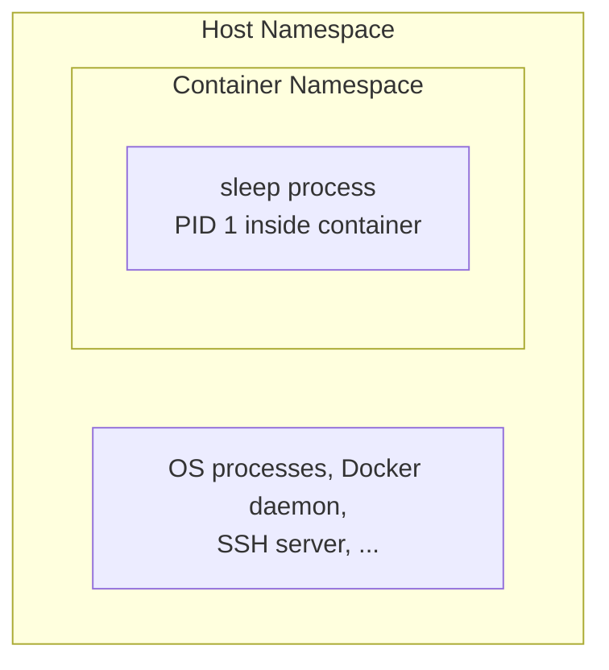

### User Security
- **By default, Docker runs container processes as root.**
- Override at runtime: `docker run --user=1000 <image>`
- Or bake it into the image via the `USER` instruction in the Dockerfile:
  ```dockerfile
  FROM ubuntu
  USER 1000
  ```

### Is Container root = Host root?
**No** — Docker limits what the container's root user can actually do, via **Linux capabilities**.

- Full root normally has unrestricted power: modify any file/permissions, manage processes, set UID/GID, network operations (bind ports, broadcast), reboot host, change system clock, etc.
- Docker containers run with only a **limited default set** of these capabilities — container root can't reboot the host or disrupt other containers by default.

### Controlling Capabilities

| Flag | Purpose |
|---|---|
| `docker run --cap-add=<CAP>` | Add a specific capability beyond the default set |
| `docker run --cap-drop=<CAP>` | Remove a capability from the default set |
| `docker run --privileged` | Run with **all** capabilities enabled (removes the restrictions entirely) |

---

## 20. Kubernetes Security Context

Maps Docker security concepts (Section 19) onto Kubernetes: `securityContext` can be set at the **Pod level** and/or **container level**.

| Level | Effect |
|---|---|
| **Pod-level** (`spec.securityContext`) | Applies to **all containers** in the pod |
| **Container-level** (`spec.containers[].securityContext`) | Applies to that container only; **overrides** the pod-level setting if both are set |

### Pod-Level Example
```yaml
apiVersion: v1
kind: Pod
metadata:
  name: web-pod
spec:
  securityContext:
    runAsUser: 1000
  containers:
    - name: ubuntu
      image: ubuntu
      command: ["sleep", "3600"]
```

### Container-Level Example (with capabilities)
```yaml
apiVersion: v1
kind: Pod
metadata:
  name: web-pod
spec:
  containers:
    - name: ubuntu
      image: ubuntu
      command: ["sleep", "3600"]
      securityContext:
        runAsUser: 1000
        capabilities:
          add: ["MAC_ADMIN"]
```

> 📌 **`capabilities` is only supported at the container level**, not pod level (capabilities are Linux/Docker container-level constructs).

| Field | Purpose |
|---|---|
| `runAsUser` | Sets the UID the container process runs as |
| `capabilities.add` | List of additional Linux capabilities to grant (container-level only) |

---

## 21. Resource Requirements — Requests, Limits & Quotas

### How Scheduling Uses Resources
- Each **node** has a fixed pool of CPU/memory.
- Each **pod** (really, each container) can declare how much it needs.
- The **Scheduler** places a pod only on a node with **sufficient resources**; if none qualify, the pod stays **`Pending`**.
  - `kubectl describe pod <name>` → shows event like *"Insufficient CPU"*.

### Requests vs Limits

| Concept | Meaning |
|---|---|
| **Request** | Minimum guaranteed amount of CPU/memory reserved for the container; used by the scheduler to pick a node |
| **Limit** | Maximum amount the container is allowed to consume |

```yaml
apiVersion: v1
kind: Pod
metadata:
  name: myapp-pod
spec:
  containers:
    - name: myapp-container
      image: myapp
      resources:
        requests:
          memory: "4Gi"
          cpu: 2
        limits:
          memory: "512Mi"
          cpu: 1
```
- `requests` / `limits` are set **per container**, not per pod (multiple containers = independent settings each).

### CPU Units
- 1 (whole) CPU = 1 vCPU (AWS) = 1 core (GCP/Azure) = 1 hyperthread.
- Fractional values allowed: `0.1` CPU = `100m` (millicpu). Minimum valid unit: `1m`.

### Memory Units

| Suffix | Meaning |
|---|---|
| `M` (mega) | 1,000,000 bytes (decimal) |
| `Mi` (mebi) | 1,048,576 bytes (binary, = 1024 KiB) |
| `G` (giga) | 1000 MB (decimal) |
| `Gi` (gibi) | 1024 MiB (binary) |

> ⚠️ `G` ≠ `Gi` — decimal vs binary. Same pattern applies to K/Ki.

### What Happens at the Limit

| Resource | Exceeding limit |
|---|---|
| **CPU** | **Throttled** — container capped, cannot exceed the limit, no crash |
| **Memory** | **Cannot be throttled** — if a container tries to use more memory than its limit (persistently), it gets **killed** → `OOMKilled` (Out Of Memory Kill), visible in pod status/logs |

### Default Behavior (⚠️ important)
- **By default, Kubernetes sets NO request or limit** on any container.
- This means a single pod can consume all CPU/memory on a node and starve others.

### Requests/Limits Combinations — CPU Behavior

| Scenario | Result |
|---|---|
| No request, no limit | Any pod can consume all available CPU — can starve other pods |
| No request, limit set | Kubernetes sets request = limit automatically; pod guaranteed exactly that much, no more |
| Both request and limit set | Pod guaranteed the request amount, can burst up to the limit, no more |
| **Request set, no limit** ✅ recommended | Pod guaranteed its request; can use more if available, but **never starved** — if another pod needs its guaranteed share, it gets it |

- Setting hard `limits` makes sense when you need to **actively restrict** usage (e.g. multi-tenant public labs preventing cryptomining abuse).
- If you skip limits, **make sure every pod has a request set** — otherwise a pod with no request can still starve one that does, since scheduling guarantees only apply relative to requests.
- Same logic applies to memory, **except**: since memory can't be throttled, over-limit memory usage results in **termination**, not just slowdown.

### LimitRange (namespace-level defaults)

Sets **default** request/limit values for containers that don't specify their own, plus min/max bounds — applies **only to newly created pods** (no retroactive effect).

```yaml
apiVersion: v1
kind: LimitRange
metadata:
  name: cpu-resource-constraint
spec:
  limits:
    - default:
        cpu: 500m
      defaultRequest:
        cpu: 500m
      max:
        cpu: "1"
      min:
        cpu: 100m
      type: Container
```

Memory example:
```yaml
apiVersion: v1
kind: LimitRange
metadata:
  name: memory-resource-constraint
spec:
  limits:
    - default:
        memory: 1Gi
      defaultRequest:
        memory: 1Gi
      max:
        memory: 1Gi
      min:
        memory: 500Mi
      type: Container
```

### ResourceQuota (namespace-level hard cap)

Limits the **total** combined resource consumption across **all pods** in a namespace.

```yaml
apiVersion: v1
kind: ResourceQuota
metadata:
  name: my-resource-quota
  namespace: dev
spec:
  hard:
    requests.cpu: 4
    requests.memory: 4Gi
    limits.cpu: 10
    limits.memory: 10Gi
```

### Quick Comparison

| | Scope | Purpose |
|---|---|---|
| `resources.requests`/`limits` | Per-container | Individual container's guarantee/cap |
| `LimitRange` | Per-namespace | Default + min/max values for containers that don't specify their own |
| `ResourceQuota` | Per-namespace | Hard ceiling on **total** resources across all pods combined |

---

## 22. Service Accounts

### User Accounts vs Service Accounts

| | Used by | Example |
|---|---|---|
| **User account** | Humans | Admin/developer accessing the cluster |
| **Service account** | Machines/applications | Prometheus polling metrics, Jenkins deploying apps, a custom dashboard app querying the API |

### Creating & Using a Service Account

**Imperative:**
```bash
kubectl create serviceaccount dashboard-sa
kubectl create serviceaccount dashboard-sa -n dev           # in a specific namespace
kubectl create serviceaccount dashboard-sa --dry-run=client -o yaml > sa.yaml   # generate YAML
```

**Declarative (YAML):**
```yaml
apiVersion: v1
kind: ServiceAccount
metadata:
  name: dashboard-sa
  namespace: default
```
`kubectl create -f sa.yaml`

**Inspecting / managing:**

| Command | Purpose |
|---|---|
| `kubectl get serviceaccount` (or `sa`) | List service accounts in the current namespace |
| `kubectl describe serviceaccount dashboard-sa` | Show details (and tokens/secrets on pre-1.24 clusters) |
| `kubectl delete serviceaccount dashboard-sa` | Delete a service account |
| `kubectl set serviceaccount deployment <name> dashboard-sa` | Change the service account of an existing Deployment |

- **Pre-v1.22 behavior**: creating a service account automatically created a **token** stored inside a **Secret** object (e.g. `dashboard-sa-token-kbbdm`), linked to the service account.
  - View it: `kubectl describe secret <secret-name>`
  - Use the token as a **Bearer token** in API calls: `Authorization: Bearer <token>`

### Mounting a Service Account into a Pod
- If the third-party app is **hosted on the cluster itself**, you don't need to manually copy tokens — Kubernetes can auto-mount the service account's token as a volume into the pod.
- **Every namespace has a `default` service account** automatically. Every pod that doesn't specify one gets the `default` service account + its token **auto-mounted** at:
  ```
  /var/run/secrets/kubernetes.io/serviceaccount/
  ```
  containing (among other files) a `token` file with the actual token content.
- The `default` service account is **heavily restricted** (basic API queries only).

### Using a Custom Service Account in a Pod
```yaml
apiVersion: v1
kind: Pod
metadata:
  name: my-dashboard-pod
spec:
  serviceAccountName: dashboard-sa
  containers:
    - name: my-dashboard
      image: my-dashboard-image
```

> ⚠️ You **cannot edit** the service account of an existing **Pod** — must delete & recreate.
> ✅ For a **Deployment**, editing the service account is fine — a template change triggers an automatic rollout (new pods created with the right service account).

### Opting Out of Auto-Mounting

The `automountServiceAccountToken: false` field can be set in **two places**, and the location differs:

**1. On the Pod** — under `spec` (affects only that pod):
```yaml
apiVersion: v1
kind: Pod
metadata:
  name: my-dashboard-pod
spec:
  automountServiceAccountToken: false
  serviceAccountName: dashboard-sa
  containers:
    - name: my-dashboard
      image: my-dashboard-image
```

**2. On the ServiceAccount** — as a **top-level field** (a sibling of `metadata`, **not** under `spec` — ServiceAccounts have no `spec`). Affects every pod that uses this service account:
```yaml
apiVersion: v1
kind: ServiceAccount
metadata:
  name: dashboard-sa
automountServiceAccountToken: false
```

> 📌 If both are set, the **Pod-level setting takes precedence** over the ServiceAccount-level setting.
> 📌 There's no imperative flag for this on `kubectl create serviceaccount` — generate the YAML with `--dry-run=client -o yaml`, add the field, then create it.

### Mounting the Token Manually (when auto-mount is off)

With `automountServiceAccountToken: false`, the pod gets **no token at all**. If the app still needs API access, you mount one yourself, ideally at the same standard path so the app works unchanged: `/var/run/secrets/kubernetes.io/serviceaccount`.

**Option 1 — Projected volume (recommended; short-lived, auto-refreshed token)**

This reproduces what Kubernetes does automatically, but under your control:
```yaml
apiVersion: v1
kind: Pod
metadata:
  name: my-dashboard-pod
spec:
  automountServiceAccountToken: false
  serviceAccountName: dashboard-sa
  containers:
    - name: my-dashboard
      image: my-dashboard-image
      volumeMounts:
        - name: sa-token
          mountPath: /var/run/secrets/kubernetes.io/serviceaccount
          readOnly: true
  volumes:
    - name: sa-token
      projected:
        sources:
          - serviceAccountToken:
              path: token
              expirationSeconds: 3600
          - configMap:
              name: kube-root-ca.crt
              items:
                - key: ca.crt
                  path: ca.crt
          - downwardAPI:
              items:
                - path: namespace
                  fieldRef:
                    fieldPath: metadata.namespace
```

| Source | File created | Purpose |
|---|---|---|
| `serviceAccountToken` | `token` | Time-bound token (via TokenRequest API), refreshed automatically by kubelet |
| `configMap: kube-root-ca.crt` | `ca.crt` | Cluster CA certificate, so the app can trust the API server (this ConfigMap exists in every namespace) |
| `downwardAPI` | `namespace` | The pod's namespace |

**Option 2 — Mount the non-expiring token Secret** (the `kubernetes.io/service-account-token` Secret from earlier):
```yaml
spec:
  automountServiceAccountToken: false
  serviceAccountName: dashboard-sa
  containers:
    - name: my-dashboard
      image: my-dashboard-image
      volumeMounts:
        - name: sa-token
          mountPath: /var/run/secrets/kubernetes.io/serviceaccount
          readOnly: true
  volumes:
    - name: sa-token
      secret:
        secretName: dashboard-sa-token
```
- This Secret already contains `token`, `ca.crt` and `namespace`, so one `secret` volume is enough.
- ⚠️ The token never expires. Prefer Option 1 unless you have a specific reason.

> 💡 Both options need `volumeMounts[].name` to match `volumes[].name` (`sa-token`), as with any volume.

### Version Changes (v1.22 → v1.24) ⭐

| Version | Change |
|---|---|
| **Pre-1.22** | Service account creation auto-creates a Secret with a **non-expiring**, non-audience-bound JWT token — security/scalability concern (checkable at [jwt.io](https://jwt.io)) |
| **v1.22** | **TokenRequestAPI** introduced (KEP-1205): pods now get a token that is **time-bound, audience-bound, object-bound** — generated on-the-fly and mounted as a **projected volume** (not a static Secret) |
| **v1.24** | (KEP-2799) Creating a service account **no longer auto-creates a Secret/token** at all. To get a token manually: |

```bash
kubectl create token <service-account-name>
```
- Prints a token to the screen with a **default 1-hour expiry** (configurable, e.g. `kubectl create token dashboard-sa --duration=2h`).
- Decoding this token (e.g. at jwt.io) shows an **expiry claim**, unlike the old-style tokens.

### Creating a Non-Expiring Token Manually (post-1.24, if truly needed)
```yaml
apiVersion: v1
kind: Secret
type: kubernetes.io/service-account-token
metadata:
  name: dashboard-sa-token
  annotations:
    kubernetes.io/service-account.name: dashboard-sa
```
- The named service account **must already exist** before creating this secret, or it won't be linked.
- ⚠️ Kubernetes docs recommendation: only do this if you **can't** use the TokenRequestAPI, and only if you're okay with the security exposure of a non-expiring credential. **Prefer `kubectl create token`** or the automatic pod-mounted projected-volume token wherever possible.

---

## 23. Taints & Tolerations

### Analogy
A **taint** = bug repellent sprayed on a person (node). A **toleration** = a bug's immunity to that specific smell. Only bugs (pods) tolerant of the specific repellent can land on that person (node). Both conditions matter: the taint on the node, and the pod's toleration to it.

> ⚠️ Taints/tolerations are **not** a security mechanism — they're purely about **scheduling restrictions**.

### Core Rule
- **Taints** are set on **nodes**.
- **Tolerations** are set on **pods**.
- By default, pods have **no tolerations** → they can't be scheduled on any tainted node unless explicitly given a matching toleration.

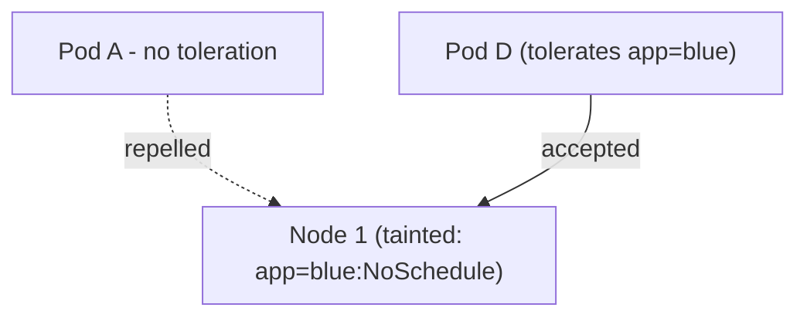

### Taint Effects

| Effect | Behavior |
|---|---|
| `NoSchedule` | New pods without matching toleration **won't be scheduled** on the node |
| `PreferNoSchedule` | System **tries to avoid** placing non-tolerant pods there, but **not guaranteed** |
| `NoExecute` | New non-tolerant pods won't be scheduled, **AND existing non-tolerant pods already on the node get evicted** |

### Commands & Syntax

**Tainting a node:**
```bash
kubectl taint nodes node1 app=blue:NoSchedule
```
Format: `kubectl taint nodes <node-name> <key>=<value>:<taint-effect>`

**Viewing taints on a node:**
```bash
kubectl describe node node1 | grep Taints
```

**Removing a taint from a node** — repeat the exact same taint command and add a **trailing `-`** (minus) at the end:
```bash
kubectl taint nodes node1 app=blue:NoSchedule-
```
Format: `kubectl taint nodes <node-name> <key>=<value>:<taint-effect>-`

| Variant | Effect |
|---|---|
| `kubectl taint nodes node1 app=blue:NoSchedule-` | Removes that exact taint (key, value and effect) |
| `kubectl taint nodes node1 app:NoSchedule-` | Removes the taint by key + effect (value not needed) |
| `kubectl taint nodes node1 app-` | Removes **all** taints with key `app`, whatever the effect |

Example: removing the default control-plane taint so pods can be scheduled there:
```bash
kubectl taint nodes controlplane node-role.kubernetes.io/control-plane:NoSchedule-
```
> 📌 On older clusters the key is `node-role.kubernetes.io/master` instead of `node-role.kubernetes.io/control-plane` — check the real key first with `kubectl describe node <name> | grep Taints`.

**Adding a toleration to a pod:**
```yaml
apiVersion: v1
kind: Pod
metadata:
  name: myapp-pod
spec:
  containers:
    - name: nginx-container
      image: nginx
  tolerations:
    - key: "app"
      operator: "Equal"
      value: "blue"
      effect: "NoSchedule"
```
> ⚠️ All toleration values must be in **quotes** (strings).

### Important Clarifications
- Taints/tolerations **only restrict what a node will accept** — they do **not** guarantee a tolerant pod will actually land on that specific node. If other untainted nodes exist, the tolerant pod might still be scheduled elsewhere.
- To **force** a pod onto a specific node (rather than just allow it), you need **Node Affinity** (separate concept, covered next).
- `NoExecute` on a node will **evict already-running pods** that don't tolerate it — even if they were placed before the taint existed.

### Master/Control-Plane Node Taint
- Kubernetes **automatically taints the master node** at cluster setup to prevent workloads being scheduled there (best practice: don't run application pods on the control plane).
- View it:
  ```bash
  kubectl describe node kube-master
  # look for the Taints: section
  ```
- This can be modified/removed, but generally shouldn't be for production clusters.

---

## 24. Node Selectors

### Problem
You have nodes with different hardware (e.g. 2 small nodes, 1 large node) and want certain pods (e.g. heavy data-processing jobs) to only run on the large node. By default, the scheduler can place any pod on any node.

> 📌 Note the difference from taints/tolerations: taints *repel* pods from a node unless tolerant; node selectors (and affinity) *attract/restrict* a pod *to* specific nodes. They solve related but distinct problems and are often used together.

### Step 1 — Label the Node
```bash
kubectl label nodes node1 size=large
```
Format: `kubectl label nodes <node-name> <key>=<value>`

### Step 2 — Use `nodeSelector` in the Pod Spec
```yaml
apiVersion: v1
kind: Pod
metadata:
  name: myapp-pod
spec:
  containers:
    - name: data-processor
      image: data-processor
  nodeSelector:
    size: large
```
- The pod will now only be scheduled on nodes with the label `size=large`.

### Limitations of `nodeSelector`
- Only supports simple **exact-match** logic (single key=value).
- **Cannot express**: OR conditions ("large OR medium"), NOT conditions ("not small"), or other complex logic.
- For these more advanced requirements → **Node Affinity** (covered next).

---

## 25. Node Affinity

Same goal as `nodeSelector` (control which nodes a pod lands on), but supports **advanced expressions**: OR logic, NOT logic, existence checks, etc.

### Definition File

```yaml
apiVersion: v1
kind: Pod
metadata:
  name: myapp-pod
spec:
  containers:
    - name: data-processor
      image: data-processor
  affinity:
    nodeAffinity:
      requiredDuringSchedulingIgnoredDuringExecution:
        nodeSelectorTerms:
          - matchExpressions:
              - key: size
                # ---------------
                # operator: Exists
                # ---------------
                # operator: NotIn
                # values:
                #   - small
                # ---------------
                operator: In
                values:
                  - large
                  - medium
```

- `nodeSelectorTerms` → `matchExpressions` is a **list** of `key`/`operator`/`values` objects.

### Operators

| Operator | Meaning |
|---|---|
| `In` | Node's label value must be **one of** the listed values (e.g. `large` or `medium`) |
| `NotIn` | Node's label value must **not** be any of the listed values |
| `Exists` | Node just needs the **key** to exist (no `values` needed — doesn't compare values) |
| (others) | `Gt`, `Lt`, `DoesNotExist`, etc. — check docs for full list |

### Affinity Types (the "sentence" property names)

The type name encodes **two lifecycle phases**: "during scheduling" (pod doesn't exist yet) and "during execution" (pod is already running).

| Type | During Scheduling (new pod) | During Execution (already running) |
|---|---|---|
| `requiredDuringSchedulingIgnoredDuringExecution` | **Mandatory** — if no matching node exists, pod **won't be scheduled** | Changes to node labels **ignored** — running pod stays put |
| `preferredDuringSchedulingIgnoredDuringExecution` | **Best-effort** — scheduler tries to match, but places the pod anywhere if no match found | Changes to node labels **ignored** — running pod stays put |
| *(planned, not yet available at time of recording)* `requiredDuringSchedulingRequiredDuringExecution` | Mandatory at scheduling | Would **evict** a running pod if node labels later change and no longer match |

> 📌 **Currently (both available types) use "IgnoredDuringExecution"** — meaning once a pod is running, label changes on its node do **not** affect it, whether the node still matches or not.

### Choosing a Type
- Use **`required...`** when placement is critical (pod must not run anywhere else) — accepts the risk of the pod staying unscheduled if no match.
- Use **`preferred...`** when running the workload matters more than exact placement — accepts the risk of landing on a non-ideal node rather than not running at all.

---

## 26. Taints/Tolerations + Node Affinity Combined

### The Problem
Shared cluster, 3 "colored" nodes (blue/red/green) and 3 matching pods, plus **other teams' pods/nodes** in the same cluster. Goal: **perfect 1:1 dedication** —
- Blue pod → blue node only
- Red pod → red node only
- Green pod → green node only
- **No other pods** should land on these 3 nodes, and **these pods should never** land on other nodes.

### Why Neither Alone Is Enough

| Approach alone | What it solves | What it misses |
|---|---|---|
| **Taints + Tolerations** only | Keeps **other teams' pods OFF** your nodes (they lack the toleration) | Doesn't stop **your pods** from landing on **other (untainted) nodes** — e.g. red pod might land on an unrelated node since nothing forces it toward the red node specifically |
| **Node Affinity** only | Keeps **your pods ON** your intended nodes | Doesn't stop **other teams' pods** from also landing on your nodes (nothing repels them) |

### The Solution: Combine Both

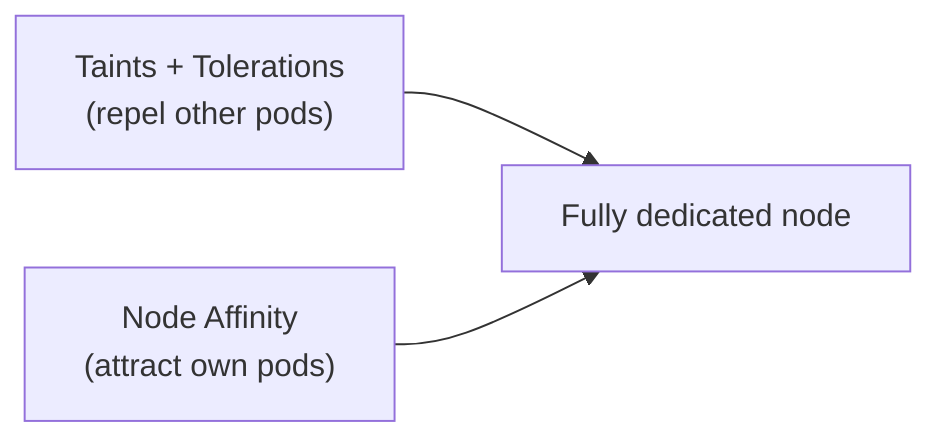

1. **Taint** each node with its color (`kubectl taint nodes node1 color=blue:NoSchedule`) and add a matching **toleration** to the corresponding pod → prevents **other pods** from landing on your nodes.
2. **Label** each node with its color (`kubectl label nodes node1 color=blue`) and add matching **node affinity** to the pod → prevents **your pods** from landing on **other** nodes.

**Result**: taints/tolerations handle the "keep others out" half, node affinity handles the "keep mine in" half — together achieving full node dedication.

---

## 27. Multi-Container Pods

(Builds on the short intro in [Section 3](#3-pods--basic-concepts).)

### Why Multi-Container Pods
- Microservices split a large monolith into small, independent, reusable services — each developed, deployed and scaled separately.
- Sometimes two services must work **together**, one-to-one — e.g. a **web server paired with a main app**, or a helper alongside an app. You don't want to merge their code (they target different features), but you need **one helper instance per app instance**, scaling up and down together.
- Solution: put both containers in the **same Pod**.

### What Containers in the Same Pod Share

| Shared | Benefit |
|---|---|
| **Lifecycle** | Created together, destroyed together |
| **Network namespace** | Reach each other via `localhost` — no Service needed between them |
| **Storage volumes** | Can access the same volumes — no extra volume-sharing setup |

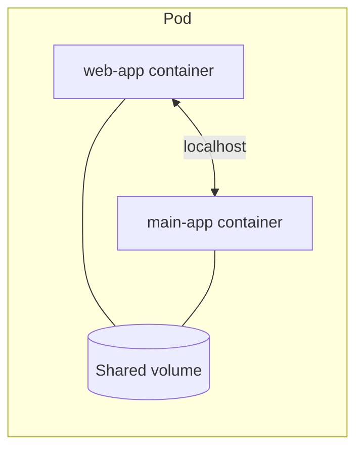

### Definition File
`spec.containers` is a **list** precisely so a pod can hold several containers — just add another item:

```yaml
apiVersion: v1
kind: Pod
metadata:
  name: simple-webapp
  labels:
    name: simple-webapp
spec:
  containers:
    - name: web-app
      image: web-app
      ports:
        - containerPort: 8080
    - name: main-app
      image: main-app
```

### Handy Commands (specifying which container)
When a pod has more than one container, `-c` selects the target container:

| Command | Purpose |
|---|---|
| `kubectl get pods` | `READY` column shows `2/2` when both containers are up |
| `kubectl logs <pod> -c <container>` | Logs of one specific container |
| `kubectl exec -it <pod> -c <container> -- sh` | Shell into one specific container |

> 📌 This basic form is the **co-located containers** pattern (first pattern below).

### Creating Multi-Container Pods Imperatively

`kubectl run` creates a pod with **one** container: it has a single `--image` and no per-container flags, so you can't add a second container with it. For a pod, use the usual **generate, edit, create** workflow (see [Section 10](#10-imperative-commands-exam-tip)):

```bash
kubectl run simple-webapp --image=web-app --port=8080 --dry-run=client -o yaml > pod.yaml
# edit pod.yaml: add another item under spec.containers
kubectl create -f pod.yaml
```

**Deployments are the exception**: `kubectl create deployment` accepts `--image` **several times**, one per container:
```bash
kubectl create deployment my-dep --image=web-app --image=main-app
```
- The flags aren't per-container, so for anything specific to one container (its own command, ports, env, ...), generate the YAML with `--dry-run=client -o yaml` and edit it.
- There are **no flags at all** for init containers or sidecars. Always generate the YAML and add the `initContainers` section by hand (see the patterns below).

### Design Patterns

| Pattern | Defined under | Startup order | Lifetime | Typical use |
|---|---|---|---|---|
| **Co-located containers** | `containers` | **No order guaranteed** — all start together | Whole pod lifecycle | Two tightly dependent services |
| **Init container** | `initContainers` | **Sequential, in listed order**; each runs to completion before the next, then the main app starts | Runs once, then **exits** | Setup/wait steps (e.g. wait for DB or API) |
| **Sidecar container** | `initContainers` + `restartPolicy: Always` | Starts **before** the main app (in listed order) | **Keeps running** for the whole pod life; stopped after the main app ends | Log shipper, anything that must be up before the app and outlive it |

**Co-located vs Sidecar** — both run for the pod's whole life. The difference is **ordering**: co-located containers are just items in an array with no startup order, while a sidecar is guaranteed to start first.

#### 1. Co-located containers
Both containers listed under `containers` (see the example above). They start together, with no startup order.

#### 2. Init containers

**Why they exist**: in a normal multi-container pod, every container is expected to keep running for the pod's whole life (e.g. a web app plus a log agent). Init containers are for processes that must **run to completion** instead, such as:
- pulling code or a binary from a repository for the main app (a **one-time** task when the pod is first created)
- waiting for an external service or database to be up before the app starts

An init container is configured like any other container, but in a separate `initContainers` list. When the pod is created, each init container runs **to completion**, and the main app starts only after all of them have finished.

**Example: one-time setup task**
```yaml
apiVersion: v1
kind: Pod
metadata:
  name: myapp-pod
  labels:
    app: myapp
spec:
  containers:
    - name: myapp-container
      image: busybox:1.28
      command: ['sh', '-c', 'echo The app is running! && sleep 3600']
  initContainers:
    - name: init-myservice
      image: busybox
      command: ['sh', '-c', 'git clone <some-repository-that-will-be-used-by-application> ;']
```

**Example: wait for dependencies (several init containers, run in order)**
```yaml
apiVersion: v1
kind: Pod
metadata:
  name: myapp-pod
  labels:
    app: myapp
spec:
  containers:
    - name: myapp-container
      image: busybox:1.28
      command: ['sh', '-c', 'echo The app is running! && sleep 3600']
  initContainers:
    - name: init-myservice
      image: busybox:1.28
      command: ['sh', '-c', 'until nslookup myservice; do echo waiting for myservice; sleep 2; done;']
    - name: init-mydb
      image: busybox:1.28
      command: ['sh', '-c', 'until nslookup mydb; do echo waiting for mydb; sleep 2; done;']
```

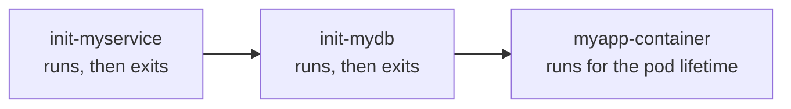

- Multiple init containers run **one at a time, in the order listed**. This is how you define a startup order.
- If an init container fails, Kubernetes keeps retrying it until it succeeds, and the main container does not start until then.
- While they run, `kubectl get pods` shows a status like `Init:0/2`. View an init container's logs with `kubectl logs <pod> -c <init-container>`.

> 📌 The course words the failure case as "Kubernetes restarts the Pod repeatedly". Strictly, the kubelet retries the failed **init container** (per the pod's `restartPolicy`); with `restartPolicy: Never` the pod is instead marked as failed.

#### 3. Sidecar containers
Declared as an **init container** with `restartPolicy: Always`. That makes it start before the main app but **keep running** instead of exiting.

```yaml
apiVersion: v1
kind: Pod
metadata:
  name: myapp-pod
spec:
  initContainers:
    - name: log-shipper
      image: filebeat
      restartPolicy: Always
  containers:
    - name: main-app
      image: main-app
```

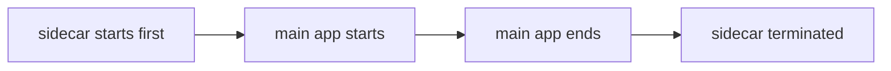

- **Example (ELK stack)**: a **Filebeat** sidecar ships logs to **Elasticsearch**, which **Kibana** visualizes. Because the sidecar starts before the app and stops after it, it captures both the **startup logs** and any **termination logs** (e.g. after a crash), which helps diagnose bugs.
- This relies on native sidecar support in Kubernetes (beta from v1.29, GA in v1.33), so check your cluster version.

---

## 28. Observability — Readiness Probes

The observability topics are readiness probes, liveness probes, logging and monitoring. This section covers **readiness probes**.

### Recap: Pod Status vs Pod Conditions

**Pod status** gives a high-level summary of where the pod is in its lifecycle (only one value at a time):

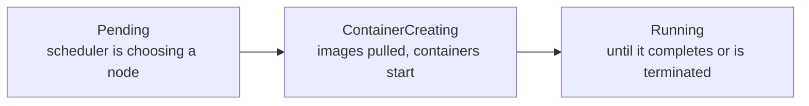

- Stuck in `Pending` (no node found)? `kubectl describe pod <name>` shows exactly why.
- Status is shown in `kubectl get pods`.

**Pod conditions** complement the status: an array of true/false values with more detail.

| Condition | Set to `True` when |
|---|---|
| `PodScheduled` | The pod has been scheduled onto a node |
| `Initialized` | The pod has been initialized |
| `ContainersReady` | All containers in the pod are ready |
| `Ready` | The pod itself is ready, meaning the app is running and **can accept user traffic** |

- View them with `kubectl describe pod <name>` (look for the **Conditions** section). The `READY` column of `kubectl get pods` also reflects it.

### The Problem
- By default, Kubernetes assumes a container is **ready as soon as it starts**, so it sets `Ready` to `True` immediately.
- Apps take different amounts of time to be truly ready: a script takes milliseconds, a database a few seconds, a web server or Jenkins can take tens of seconds to minutes.
- A **Service** routes traffic based on the pod's `Ready` condition, so it sends users to a pod whose app isn't running yet.

### The Solution: Readiness Probe
You define what "ready" means for your app, and Kubernetes only sets `Ready` to `True` once the **probe passes**. Until then, the Service sends **no traffic** to the pod.

| Probe type | Use case | Field |
|---|---|---|
| **HTTP** | Web app: does the API respond? | `httpGet` (with `path` and `port`) |
| **TCP** | Database: is the socket listening? | `tcpSocket` (with `port`) |
| **Command** | Custom script that exits successfully when ready | `exec` (with `command` as an array) |

**HTTP probe:**
```yaml
apiVersion: v1
kind: Pod
metadata:
  name: simple-webapp
  labels:
    name: simple-webapp
spec:
  containers:
    - name: simple-webapp
      image: simple-webapp
      ports:
        - containerPort: 8080
      readinessProbe:
        httpGet:
          path: /api/ready
          port: 8080
        initialDelaySeconds: 10
        periodSeconds: 5
        failureThreshold: 8
```

**TCP probe:**
```yaml
      readinessProbe:
        tcpSocket:
          port: 3306
```

**Command (exec) probe:**
```yaml
      readinessProbe:
        exec:
          command:
            - cat
            - /app/is_ready
```

### Extra Options

| Option | Purpose | Default |
|---|---|---|
| `initialDelaySeconds` | Wait this long before the first probe (use when you know the app needs time to warm up) | `0` |
| `periodSeconds` | How often to probe | `10` |
| `failureThreshold` | Consecutive failures before the container is marked **not ready** | `3` |

> 📌 The lecture says the probe "stops" after 3 failed attempts. Strictly, `failureThreshold` is the number of consecutive failures before the container is marked **not ready**; Kubernetes keeps probing, and the pod becomes ready again as soon as the probe passes.
> 📌 A failing readiness probe only stops traffic being sent to the pod. It does **not** restart the container (that is the job of a **liveness probe**).
> 📌 You **can't add or change a probe on a running Pod**: `readinessProbe` isn't an editable pod field (see [Section 4](#4-pods--yaml-definition-files)), and `kubectl set` has no probe option. Export the pod (`kubectl get pod <name> -o yaml > pod.yaml`), add the probe, then recreate it with `kubectl replace --force -f pod.yaml`. For a **Deployment**, `kubectl edit deployment <name>` works.

### Why It Matters with Multiple Pods (ReplicaSet/Deployment + Service)
Two pods are already serving users and a third pod is added, but it takes a minute to warm up.

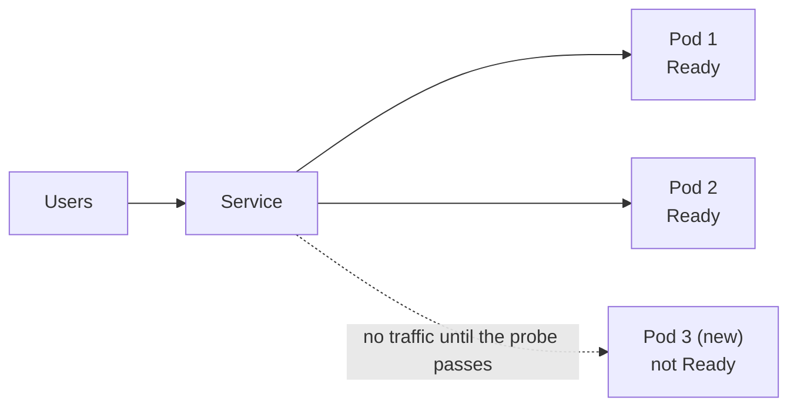

- **Without** a readiness probe: the Service sends traffic to the new pod immediately, so some users get a service disruption.
- **With** a readiness probe: the Service keeps using only the older pods and adds the new one once it is ready, so no users are affected.

---

## 29. Observability — Liveness Probes

### The Problem
- **Plain Docker**: if the app crashes, the container exits and **stays dead** until you manually create a new one.
- **Kubernetes**: restarts a crashed container automatically. The `RESTARTS` count in `kubectl get pods` goes up each time.
- **Gap**: what if the app is **stuck but the container is still alive** (e.g. a bug puts it in an infinite loop)? Kubernetes sees a running container and assumes the app is up, but users aren't being served.

### The Solution: Liveness Probe
A liveness probe **periodically tests whether the app is actually healthy**. If the test fails, the container is considered **unhealthy** and is **destroyed and recreated** (restarted). As the developer, you define what "healthy" means.

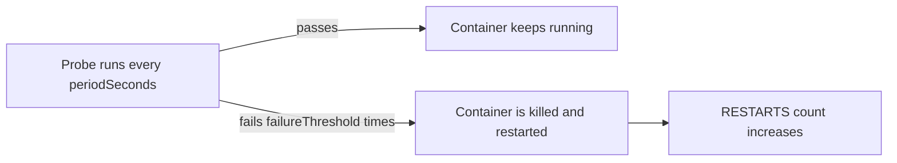

It is configured like a readiness probe, with `livenessProbe` instead of `readinessProbe`, and the same three probe types:

| Probe type | Use case | Field |
|---|---|---|
| **HTTP** | Web app: does the API respond? | `httpGet` (with `path` and `port`) |
| **TCP** | Database: is the socket listening? | `tcpSocket` (with `port`) |
| **Command** | Custom check that exits successfully when healthy | `exec` (with `command` as an array) |

**HTTP probe:**
```yaml
apiVersion: v1
kind: Pod
metadata:
  name: simple-webapp
  labels:
    name: simple-webapp
spec:
  containers:
    - name: simple-webapp
      image: simple-webapp
      ports:
        - containerPort: 8080
      livenessProbe:
        httpGet:
          path: /api/healthy
          port: 8080
        initialDelaySeconds: 10
        periodSeconds: 5
        failureThreshold: 8
```

**TCP probe:**
```yaml
      livenessProbe:
        tcpSocket:
          port: 3306
```

**Command (exec) probe:**
```yaml
      livenessProbe:
        exec:
          command:
            - cat
            - /app/is_healthy
```

### Extra Options (same as readiness probes)

| Option | Purpose | Default |
|---|---|---|
| `initialDelaySeconds` | Wait before the first probe | `0` |
| `periodSeconds` | How often to probe | `10` |
| `successThreshold` | Consecutive successes needed to count as healthy again | `1` (must be `1` for liveness probes) |
| `failureThreshold` | Consecutive failures before the container is declared unhealthy | `3` |

### Readiness vs Liveness

| | Readiness probe | Liveness probe |
|---|---|---|
| Question | Is the app **ready to serve traffic**? | Is the app **still healthy/alive**? |
| On failure | Pod gets **no traffic** from Services; container is **not** restarted | Container is **restarted** |
| Field | `readinessProbe` | `livenessProbe` |

They are independent and are often configured together on the same container:
```yaml
      readinessProbe:
        httpGet:
          path: /api/ready
          port: 8080
      livenessProbe:
        httpGet:
          path: /api/healthy
          port: 8080
```

> 💡 To see probe failures and restarts: `kubectl get pods` (the `RESTARTS` column) and `kubectl describe pod <name>` (the Events section).

---

## 30. Observability — Logging

### Logging in Docker
- The app writes its events to **standard output (stdout)**.
- Running detached (`docker run -d`) hides them, so you read them with `docker logs`.

### Logging in Kubernetes
Same idea: whatever the container writes to stdout is read with `kubectl logs`.

| Action | Docker | Kubernetes |
|---|---|---|
| View logs | `docker logs <container-id>` | `kubectl logs <pod-name>` |
| Stream live (follow) | `docker logs -f <container-id>` | `kubectl logs -f <pod-name>` |
| Pod with multiple containers | n/a | `kubectl logs -f <pod-name> -c <container-name>` |

### Multi-Container Pods
Logs belong to a **specific container**, so with several containers in the pod you must say which one with `-c` (`--container`).

```yaml
apiVersion: v1
kind: Pod
metadata:
  name: event-simulator-pod
spec:
  containers:
    - name: event-simulator
      image: kodekloud/event-simulator
    - name: image-processor
      image: image-processor
```

```bash
kubectl logs -f event-simulator-pod -c event-simulator
```

> 📌 In the lecture, omitting `-c` fails and asks you to name a container. Newer kubectl versions instead default to the first container (or the one set by the `kubectl.kubernetes.io/default-container` annotation) and print a `Defaulted container ...` message. Always pass `-c` so you get the container you intend.

### Handy Extras (not in the lecture, but useful for troubleshooting)

| Command | Purpose |
|---|---|
| `kubectl logs <pod> --previous` (or `-p`) | Logs of the **previous** (crashed/restarted) container instance |
| `kubectl logs <pod> --tail=20` | Only the last 20 lines |
| `kubectl logs <pod> --all-containers=true` | Logs from every container in the pod |

> 📌 This basic `kubectl logs` is all that is needed for the CKAD. Advanced logging setups and third-party tools are optional extras.

---

## 31. Observability — Monitoring

### What Is Commonly Monitored

| Level | Typical metrics | What people want to know |
|---|---|---|
| **Node** | Number of nodes; how many are healthy (`Ready`); CPU, memory, network and disk usage | Is there enough capacity? Is a node failing or overloaded? Do we need more nodes? |
| **Pod** | Number of pods; pod status and restart counts; CPU and memory usage per pod | Which pods use the most resources? Are any crash-looping or stuck in `Pending`? Are requests/limits set sensibly? |
| **Application** | Request rate, error rate, response latency | Are users being served well? (Usually needs app-level tools, e.g. Prometheus) |

Typical questions monitoring answers:
- Is the cluster healthy, and is there room to schedule more workloads?
- Which node or pod is consuming the most CPU or memory?
- Are pods restarting or failing health checks?
- Is performance degrading over time? (This needs **historical** data.)

Quick checks you already have: `kubectl get nodes` (node health), `kubectl get pods` (status and `RESTARTS`), and `kubectl top` (current CPU and memory, see below).

> 📌 The metrics server covers only **current CPU and memory** of nodes and pods. It does **not** give network or disk metrics, application-level metrics, or history.

### Monitoring Solutions

Kubernetes has no full built-in monitoring solution, so you pick a tool. The usual options:

| Solution | Type | Notes |
|---|---|---|
| **Metrics Server** | Open source | Lightweight, in-memory, current CPU/memory only (covered below). Replaced the older, now-deprecated **Heapster** |
| **Prometheus** | Open source | Collects metrics into a time-series database, so you get **history**; has its own query language (PromQL) and alerting; often paired with Grafana dashboards |
| **Elastic Stack** (Elasticsearch, Logstash, Kibana, Beats) | Open source | Mainly log collection, search and visualization (as in the Filebeat sidecar example in [Section 27](#27-multi-container-pods)) |
| **Datadog** | Proprietary (SaaS) | Hosted monitoring platform |
| **Dynatrace** | Proprietary (SaaS) | Hosted monitoring and observability platform |

> 📌 For the CKAD, the Metrics Server and `kubectl top` are what you need. The others are good to recognize by name.

### Metrics Server
- **One metrics server per cluster.**
- It collects metrics from every **node and pod**, aggregates them, and keeps them **in memory only**.
- Because nothing is written to disk, there is **no historical data**. For history, use a more advanced monitoring solution (e.g. Prometheus, Datadog).

### Where the Metrics Come From

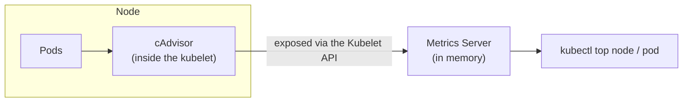

- The **kubelet** runs on every node (it takes instructions from the API server and runs the pods).
- Inside the kubelet is **cAdvisor** (Container Advisor). It collects performance metrics from the pods and exposes them through the **Kubelet API**, so the metrics server can read them.

### Deploying the Metrics Server

| Environment | How |
|---|---|
| **Minikube** | `minikube addons enable metrics-server` |
| **Other clusters** | Clone the metrics-server GitHub repo and create the deployment files with `kubectl create -f` |

**Method shown in the lecture:**
```bash
git clone https://github.com/kubernetes-sigs/metrics-server.git
cd metrics-server
kubectl create -f deploy/1.8+/
```

**Current method** (what the project's README documents now):
```bash
kubectl apply -f https://github.com/kubernetes-sigs/metrics-server/releases/latest/download/components.yaml
```

> 📌 `deploy/1.8+/` is the folder layout of older versions of the repo. The current README documents the release manifest above (or the official Helm chart) instead, so that folder may not exist in a fresh clone.
- This deploys a set of **pods, services and roles** (in the `kube-system` namespace) so the metrics server can poll the nodes.
- Give it a little time to collect and process data before querying.

### Viewing Performance Metrics

| Command | Shows |
|---|---|
| `kubectl top node` | CPU and memory usage of each **node** |
| `kubectl top pod` | CPU and memory usage of each **pod** |

> ⚠️ `kubectl top` **needs the metrics server**. It is only a client for the Metrics API (`metrics.k8s.io`) that the metrics server provides. Without one it fails with `error: Metrics API not available`. Quick check: `kubectl get deployment metrics-server -n kube-system`.

Example output of `kubectl top node` (illustrative values):
```
NAME     CPU(cores)   CPU%   MEMORY(bytes)   MEMORY%
master   166m         8%     1337Mi          68%
```
- CPU is shown in **millicores**: `166m` = 0.166 of a core, which was **8%** of that node's CPU in the lecture.

Handy extras (not in the lecture):

| Command | Purpose |
|---|---|
| `kubectl top pod -n <namespace>` (or `-A`) | Pods in a namespace, or in all namespaces |
| `kubectl top pod --sort-by=cpu` | Sort by `cpu` or `memory` to find the heaviest pods |
| `kubectl top pod <pod> --containers` | Break usage down per container |

---

## 32. Labels, Selectors & Annotations

### The Idea
- **Labels** are properties attached to each item (e.g. `class: mammal`, `color: green`).
- **Selectors** filter items by those labels, on one criterion (`color=green`) or several (green **and** a bird).
- It's the same idea as tags on videos/blogs or filters in an online store.

In Kubernetes you can end up with hundreds or thousands of objects (pods, services, ReplicaSets, Deployments). Labels let you group them by type, application or function, and selectors let you pick them out.

### Labels on an Object
Under `metadata.labels`, as key-value pairs (as many as you like):
```yaml
apiVersion: v1
kind: Pod
metadata:
  name: simple-webapp
  labels:
    app: App1
    function: Front-end
spec:
  containers:
    - name: simple-webapp
      image: simple-webapp
```

> ⚠️ Label (and annotation) **values must be strings**. Quote numbers, e.g. `version: "1.0"`, otherwise validation fails.

### Selecting with `kubectl`

| Command | Purpose |
|---|---|
| `kubectl get pods --selector app=App1` (or `-l app=App1`) | Pods matching one label |
| `kubectl get pods -l app=App1,function=Front-end` | Pods matching **all** the listed labels (AND) |
| `kubectl get pods --show-labels` | Show each pod's labels as a column |
| `kubectl get all -l env=prod` | **All objects** (pods, services, Deployments, ReplicaSets, ...) with that label, not just pods |
| `kubectl get all -l env=prod,bu=finance,tier=frontend` | Same, matching several labels at once (AND) |
| `kubectl get all -l env=prod -A` | Same, across **all namespaces** |

> 📌 `kubectl get all` covers the common workload types (pods, services, Deployments, ReplicaSets, Jobs, ...) but **not every resource**. ConfigMaps, Secrets and PersistentVolumeClaims, for example, are not included. Only the current namespace is searched unless you add `-A`.
> 📌 `k` is a common shell alias for `kubectl`, so `k get all -l env=prod` works if you have it set up.

### How Kubernetes Uses Them Internally
Objects are connected to each other through labels and selectors.

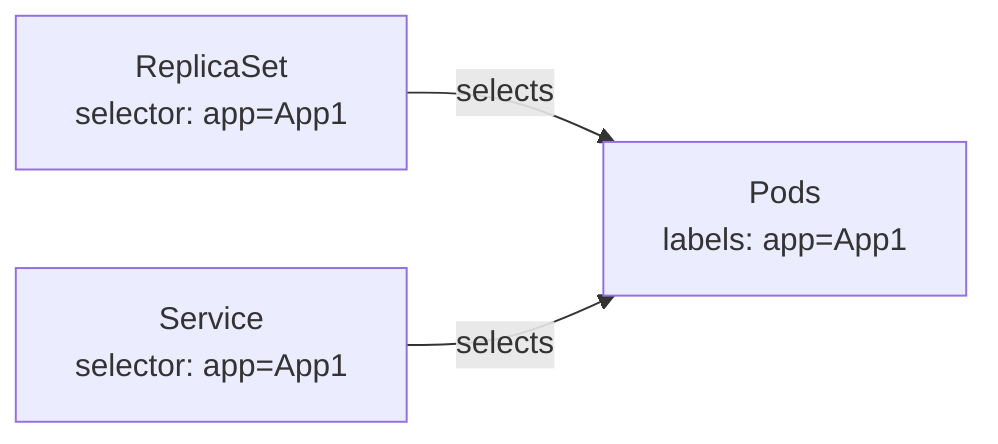

**ReplicaSet**: labels appear in **two places**, a common beginner mistake.
```yaml
apiVersion: apps/v1
kind: ReplicaSet
metadata:
  name: simple-webapp
  labels:                 # labels of the ReplicaSet itself
    app: App1
    function: Front-end
spec:
  replicas: 3
  selector:
    matchLabels:
      app: App1           # must match the POD labels below
  template:
    metadata:
      labels:             # labels on the PODS
        app: App1
        function: Front-end
    spec:
      containers:
        - name: simple-webapp
          image: simple-webapp
```

| Labels at... | Belong to |
|---|---|
| `metadata.labels` (top) | The **ReplicaSet itself** (only matter if another object needs to find the ReplicaSet) |
| `spec.template.metadata.labels` | The **pods** it creates. The `selector` must match these |

- A single label is enough if it matches correctly.
- If other pods might share that label but do a different job, list **more than one** label in the selector so only the right pods are picked up.

**Service**: works the same way, its `selector` matches the labels on the pods:
```yaml
apiVersion: v1
kind: Service
metadata:
  name: my-service
spec:
  selector:
    app: App1
  ports:
    - port: 80
      targetPort: 8080
```

### Annotations
- Labels and selectors **group and select** objects. **Annotations** only **record extra information** and are not used for selecting.
- Typical content: tool details (name, version, build information) or contact details (phone numbers, email addresses) used for integrations.

```yaml
apiVersion: v1
kind: Pod
metadata:
  name: simple-webapp
  labels:
    app: App1
    function: Front-end
  annotations:
    buildversion: "1.34"
spec:
  containers:
    - name: simple-webapp
      image: simple-webapp
```

> 📌 `annotations` lives **inside `metadata`**, as a sibling of `name` and `labels` (same indentation).

---

## 33. Deployments — Updates, Rollouts & Rollbacks

Builds on [Section 6](#6-deployments).

### Rollouts and Revisions
- Creating a Deployment triggers a **rollout**. A rollout creates a new ReplicaSet and is recorded as a **revision** (revision 1).
- When you upgrade (e.g. a new container image version), a **new rollout** runs and a new revision is created (revision 2), and so on.
- Revisions let you track changes and **roll back** to an earlier version.

| Command | Purpose |
|---|---|
| `kubectl rollout status deployment/<name>` | Watch the status of a rollout |
| `kubectl rollout history deployment/<name>` | List the revisions of a Deployment |

> 📌 Only changes to the **pod template** (`spec.template`, e.g. the image or the pod labels) trigger a new rollout and revision. Scaling (changing `replicas`) does **not**.

### Deployment Strategies

| Strategy | Behavior | Downtime |
|---|---|---|
| **Recreate** | Destroy **all** old pods, then create all the new ones | **Yes**, between old pods going down and new ones coming up |
| **RollingUpdate** (**default**) | Replace pods **one by one**: take one old pod down, bring one new pod up | No, the upgrade is seamless |

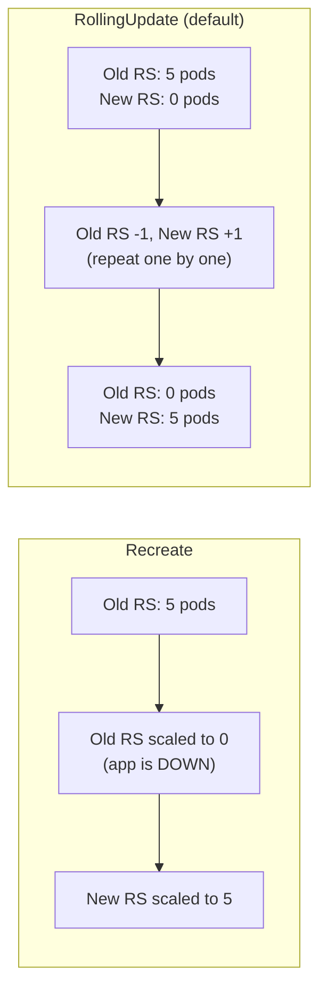

Set the strategy in the Deployment spec (if omitted, it is `RollingUpdate`):
```yaml
spec:
  replicas: 5
  strategy:
    type: RollingUpdate     # or: Recreate
    rollingUpdate:          # only valid with RollingUpdate (values shown are the defaults)
      maxSurge: 25%
      maxUnavailable: 25%
  selector: ...
  template: ...
```
- `maxSurge`: how many extra pods may exist above the desired count during the update.
- `maxUnavailable`: how many pods may be unavailable during the update.

### Updating a Deployment

| Way | Command |
|---|---|
| Edit the definition file (image version, labels, ...), then apply | `kubectl apply -f deployment-definition.yaml` |
| Update the image directly | `kubectl set image deployment/myapp-deployment nginx-container=nginx:1.9.1` |

- Format of `set image`: `<container-name>=<new-image>`.
- Either way, a new rollout starts and a new revision is created.

> ⚠️ `kubectl set image` changes the live Deployment but **not** your definition file, so the file no longer matches the cluster. Be careful when you re-apply that file later.

### What Happens Under the Hood
- **Create**: the Deployment creates a ReplicaSet, which creates the pods.
- **Upgrade**: the Deployment creates a **new ReplicaSet** and deploys the new pods there, while taking pods down in the **old ReplicaSet**.
- You can see the difference with `kubectl describe deployment <name>` (Events section):
  - **Recreate**: the old ReplicaSet is scaled down to 0 first, then the new one is scaled up to 5.
  - **RollingUpdate**: the old ReplicaSet is scaled down one at a time while the new one is scaled up one at a time.
- `kubectl get replicasets` after an upgrade shows the old ReplicaSet with **0 pods** and the new one with **5**.

### Rolling Back
```bash
kubectl rollout undo deployment/<name>
```
- Destroys the pods in the new ReplicaSet and brings the old ones back up in the old ReplicaSet.
- `kubectl get replicasets` before and after shows the counts **reversed**:

| | Old ReplicaSet | New ReplicaSet |
|---|---|---|
| After upgrade (before rollback) | 0 pods | 5 pods |
| After rollback | 5 pods | 0 pods |

### Command Summary

| Command | Purpose |
|---|---|
| `kubectl create -f deployment-definition.yaml` | Create the Deployment |
| `kubectl get deployments` | List Deployments |
| `kubectl apply -f deployment-definition.yaml` | Update from the definition file |
| `kubectl set image deployment/<name> <container>=<image>` | Update the image |
| `kubectl rollout status deployment/<name>` | Check rollout status |
| `kubectl rollout history deployment/<name>` | Show revision history |
| `kubectl rollout undo deployment/<name>` | Roll back to the previous revision |

Handy extras (not in the lecture):

| Command | Purpose |
|---|---|
| `kubectl rollout undo deployment/<name> --to-revision=2` | Roll back to a specific revision |
| `kubectl rollout history deployment/<name> --revision=2` | Show the details of one revision |
| `kubectl rollout pause deployment/<name>` / `kubectl rollout resume deployment/<name>` | Pause to batch several changes, then resume to roll them out together |

### Worked Example (nginx)

**Create, check the rollout, look at the history:**
```bash
kubectl create deployment nginx --image=nginx:1.16
kubectl rollout status deployment nginx
# deployment "nginx" successfully rolled out

kubectl rollout history deployment nginx
# REVISION  CHANGE-CAUSE
# 1         <none>

kubectl rollout history deployment nginx --revision=1
# shows the pod template of revision 1 (labels, container image nginx:1.16, ...)
```
- `--revision=N` shows the pod template of that one revision, including its image.

**Recording the change cause:** `CHANGE-CAUSE` is `<none>` by default. `--record` saves the command you ran against the revision:
```bash
kubectl set image deployment nginx nginx=nginx:1.17 --record
kubectl edit deployment nginx --record
```
```
REVISION  CHANGE-CAUSE
1         <none>
2         kubectl set image deployment nginx nginx=nginx:1.17 --record=true
3         kubectl edit deployments. nginx --record=true
```

> ⚠️ `--record` is **deprecated**: kubectl prints `Flag --record has been deprecated, --record will be removed in the future`, although it is reported to still work. The alternative is the `kubernetes.io/change-cause` annotation. Set it right after the update and it is recorded against the current revision:
> ```bash
> kubectl annotate deployment nginx kubernetes.io/change-cause="upgrade to nginx 1.17"
> ```

**Undoing a change:**
```bash
kubectl rollout undo deployment nginx                    # back to the previous revision
kubectl rollout undo deployment nginx --to-revision=1    # back to a specific revision
kubectl describe deployment nginx | grep -i image:       # verify which image is live
```
- In the example, `undo` took the Deployment from revision 3 (`nginx:latest`) back to revision 2 (`nginx:1.17`).
- Rolling back **re-applies the old revision as a new, latest revision number**, and the old number disappears from the history. The history then looked like:
```
REVISION  CHANGE-CAUSE
1         <none>
3         kubectl edit deployments.apps nginx --record=true
4         kubectl set image deployment nginx nginx=nginx:1.17 --record=true
```
- `--to-revision=1` restored the original image (`nginx:1.16`).

---

## 34. Additional Deployment Strategies

Builds on [Section 33](#33-deployments--updates-rollouts--rollbacks).

- **Recreate** and **RollingUpdate** are the only options you can set in a Deployment's `strategy.type`.
- **Blue-green** and **canary** are **not** options you can set. You build them yourself from Deployments and Services (or, better, with a service mesh like Istio, which has its own course).

### Blue-Green

Deploy the **new** version (green) **alongside** the **old** one (blue):
1. 100% of the traffic still goes to **blue**.
2. Run tests against **green**.
3. When the tests pass, switch **all** traffic to green **at once**.

```mermaid
flowchart LR
    U["Users"] --> S["Service<br/>selector: version=v1"]
    S --> B["myapp (blue)<br/>pods: version=v1"]
    G["myapp-green<br/>pods: version=v2<br/>(being tested, no traffic)"]
    S -. "after the switch:<br/>selector version=v2" .-> G
```

**Implementation with plain Deployments and a Service.** The Service picks pods by a `version` label, so the switch is just changing the selector.

**1. Blue Deployment (current version, `v1`):**
```yaml
apiVersion: apps/v1
kind: Deployment
metadata:
  name: myapp
  labels:
    app: myapp
spec:
  replicas: 5
  selector:
    matchLabels:
      app: myapp
      version: v1
  template:
    metadata:
      labels:
        app: myapp
        version: v1
    spec:
      containers:
        - name: app-container
          image: myapp-image:1.0
```

**2. Service (sends traffic to `v1` pods):**
```yaml
apiVersion: v1
kind: Service
metadata:
  name: myapp-service
spec:
  selector:
    app: myapp
    version: v1          # switch this to v2 to cut over to green
  ports:
    - port: 80
      targetPort: 8080
```

**3. Green Deployment (new version, `v2`).** A separate Deployment with a new name, new image and new `version` label. It gets **no traffic yet**, so you can test it:
```yaml
apiVersion: apps/v1
kind: Deployment
metadata:
  name: myapp-green
  labels:
    app: myapp
spec:
  replicas: 5
  selector:
    matchLabels:
      app: myapp
      version: v2
  template:
    metadata:
      labels:
        app: myapp
        version: v2
    spec:
      containers:
        - name: app-container
          image: myapp-image:2.0
```

**4. Switch the traffic.** Change the Service selector from `version: v1` to `version: v2` and apply it. All traffic now goes to the pods of the green Deployment.

Handy extra (not in the lecture), to switch without editing the file:
```bash
kubectl patch service myapp-service -p '{"spec":{"selector":{"version":"v2"}}}'
```

> 📌 The blue Deployment is still running after the switch, so rolling back is just changing the selector back to `v1`. The price is that you run **two full copies** of the app while both exist.

### Canary

Deploy the **new** version next to the old one and send only a **small percentage** of the traffic to it:
1. Most traffic still goes to the old version (the **primary** Deployment).
2. Test the new version (the **canary** Deployment) on that small share of traffic.
3. If it looks good, **upgrade the primary** Deployment to the new version (e.g. with a normal rolling update) and **delete the canary** Deployment.

**Implementation with plain Deployments and a Service.** Two problems to solve:

| Problem | Solution |
|---|---|
| Send traffic from **one Service** to the pods of **both** Deployments | Give all pods a **common label** (e.g. `app: front-end`) and make the Service selector use only that label |
| Send only a **small share** to the canary | Run only a **few canary pods** (e.g. 1). A Service spreads traffic equally across all its pods |

With 5 primary pods and 1 canary pod, the Service has 6 pods: the primary gets about **83%** of the traffic and the canary about **17%**.

```mermaid
flowchart LR
    U["Users"] --> S["Service<br/>selector: app=front-end"]
    S -->|"~83%"| P["myapp-primary<br/>5 pods (v1)"]
    S -->|"~17%"| C["myapp-canary<br/>1 pod (v2)"]
```

**1. Primary Deployment (5 pods, `v1`):**
```yaml
apiVersion: apps/v1
kind: Deployment
metadata:
  name: myapp-primary
  labels:
    app: myapp
spec:
  replicas: 5
  selector:
    matchLabels:
      app: front-end
      version: v1
  template:
    metadata:
      labels:
        app: front-end      # common label, used by the Service
        version: v1
    spec:
      containers:
        - name: app-container
          image: myapp-image:1.0
```

**2. Service (selects the common label only):**
```yaml
apiVersion: v1
kind: Service
metadata:
  name: myapp-service
spec:
  selector:
    app: front-end
  ports:
    - port: 80
      targetPort: 8080
```

**3. Canary Deployment (1 pod, new image, `v2`):**
```yaml
apiVersion: apps/v1
kind: Deployment
metadata:
  name: myapp-canary
  labels:
    app: myapp
spec:
  replicas: 1
  selector:
    matchLabels:
      app: front-end
      version: v2
  template:
    metadata:
      labels:
        app: front-end      # same common label, so the Service picks these pods up too
        version: v2
    spec:
      containers:
        - name: app-container
          image: myapp-image:2.0
```

> 📌 Each Deployment's own `selector` includes the unique `version` label so the two Deployments don't overlap. Only the **Service** selects on the shared `app` label.

**4. Finish:** once you trust the new version, update `myapp-primary` to the new image and remove the canary:
```bash
kubectl delete deployment myapp-canary
```

**Caveat**: with plain Kubernetes, the traffic split is controlled **only by the number of pods** in each Deployment. You can't say "send 1% to the canary" without about 100 pods in total. A service mesh like **Istio** lets you set the exact percentage regardless of pod count (even 1 pod each, split 1%/99%).

### Strategy Summary

| Strategy | How | Traffic to the new version | Downtime |
|---|---|---|---|
| **Recreate** | `strategy.type: Recreate` | All at once, after all old pods are destroyed | Yes |
| **RollingUpdate** (default) | `strategy.type: RollingUpdate` | Gradually, pod by pod | No |
| **Blue-green** | Two Deployments, switch the Service selector | None until the switch, then 100% at once | No |
| **Canary** | Two Deployments sharing a Service label, few canary pods | A small share first (set by the pod ratio) | No |

---

## 35. Jobs

### Two Kinds of Workloads
- **Long-running**: web servers, applications, databases. They run until you take them down.
- **Batch**: a specific task that runs and then **finishes** (a computation, image processing, analytics on a large dataset, generating a report and emailing it).

### Why a Plain Pod Isn't Enough
- **Docker**: a container runs the task, prints the result and exits. `docker ps -a` shows it as *Exited*, with the return code in brackets (`0` = success).
- **Kubernetes pod**: the container exits and the pod shows `Completed`, but Kubernetes **starts the container again**, over and over, until a threshold is reached. Kubernetes wants apps to live forever.
- The cause is the pod's **`restartPolicy`**, which defaults to `Always`.

| `restartPolicy` | Behavior |
|---|---|
| `Always` (default) | Restart the container whenever it exits |
| `OnFailure` | Restart only if the container fails (non-zero exit) |
| `Never` | Never restart |

```yaml
apiVersion: v1
kind: Pod
metadata:
  name: math-pod
spec:
  containers:
    - name: math-add
      image: ubuntu
      command: ['expr', '3', '+', '2']
  restartPolicy: Never
```

### Job vs ReplicaSet
- A **ReplicaSet** keeps a set number of pods running **at all times**.
- A **Job** runs pods **to completion** to get a given task done, creating as many pods as needed and making sure the work finishes successfully.

### Job Definition
The pod's `spec` goes under `spec.template`, just like in a ReplicaSet or Deployment.

```yaml
apiVersion: batch/v1
kind: Job
metadata:
  name: math-add-job
spec:
  template:
    spec:
      containers:
        - name: math-add
          image: ubuntu
          command: ['expr', '3', '+', '2']
      restartPolicy: Never
```
- The API version is `batch/v1` today. Verify it for your cluster version (see [Section 11](#11-kubectl-explain--api-resources): `kubectl api-resources`).
- In a Job, the pod's `restartPolicy` must be `Never` or `OnFailure`. The default `Always` is rejected.

| Command | Purpose |
|---|---|
| `kubectl create -f job-definition.yaml` | Create the Job |
| `kubectl get jobs` | List Jobs (the `COMPLETIONS` column shows e.g. `1/1`) |
| `kubectl get pods` | The Job's pod shows `Completed` with 0 restarts |
| `kubectl logs <pod-name>` | The task's output (its standard output) |
| `kubectl delete job <name>` | Delete the Job (**also deletes the pods** it created) |

> 📌 The addition example is just to learn the idea. Real Jobs usually put their result elsewhere, e.g. a processed image on a persistent volume, or an email with a report.

Handy extra (not in the lecture), generate a Job quickly:
```bash
kubectl create job math-add-job --image=ubuntu --dry-run=client -o yaml -- expr 3 + 2 > job.yaml
```

### Multiple Pods: `completions` and `parallelism`

| Field | Meaning | Default |
|---|---|---|
| `completions` | How many pods must **complete successfully** | `1` |
| `parallelism` | How many pods may run **at the same time** | `1` (one after another) |

```yaml
apiVersion: batch/v1
kind: Job
metadata:
  name: random-error-job
spec:
  completions: 3
  parallelism: 3
  template:
    spec:
      containers:
        - name: random-error
          image: kodekloud/random-error
      restartPolicy: Never
```

- **`completions: 3`** runs pods **one after another**: the next one starts only after the previous one finishes. `kubectl get jobs` then shows a desired count of 3 and a successful count of 3.
- **If a pod fails**, the Job creates **new pods** until it reaches the required number of successful completions. In the lecture's `random-error` image (which randomly succeeds or fails), pods 1 and 3 succeed, pods 2, 4 and 5 fail, and the Job keeps going until 3 have succeeded.
- **`parallelism: 3`** creates 3 pods **at once**. If 2 succeed and only 1 more is needed, the Job creates only the pods still required, until the total reaches 3 completed pods.

```mermaid
flowchart LR
    J["Job<br/>completions: 3"] --> P1["Pod 1<br/>Completed"] --> P2["Pod 2<br/>Completed"] --> P3["Pod 3<br/>Completed"]
```

Handy extras (not in the lecture):

| Field | Purpose | Default |
|---|---|---|
| `backoffLimit` | Retries before the Job is marked as failed | `6` |
| `activeDeadlineSeconds` | Maximum time the Job may run before it is stopped | none |
| `ttlSecondsAfterFinished` | Automatically delete the Job after it finishes, after this many seconds | none |

---

## 36. CronJobs

Builds on [Section 35](#35-jobs).

A **CronJob** is a Job that runs on a **schedule**, like `crontab` in Linux. For example, a Job that generates a report and emails it: `kubectl create` would run it **once, immediately**, while a CronJob runs it **periodically**.

```mermaid
flowchart LR
    C["CronJob<br/>(schedule)"] -->|"creates on schedule"| J["Job"] --> P["Pod(s)"]
```

### Definition File

```yaml
apiVersion: batch/v1
kind: CronJob
metadata:
  name: reporting-cron-job
spec:
  schedule: "*/1 * * * *"
  jobTemplate:
    spec:
      completions: 3
      parallelism: 3
      template:
        spec:
          containers:
            - name: reporting-tool
              image: reporting-tool
          restartPolicy: Never
```

- `kind: CronJob` (capital **C** and **J**).
- `spec.schedule`: a cron-style string saying when to run.
- `spec.jobTemplate`: the actual Job to run. Its `spec` is the **content of the Job definition's `spec`** (from [Section 35](#35-jobs)).

> ⚠️ The lecture says the API version is `batch/v1beta1`. That is out of date: CronJob became `batch/v1` in Kubernetes v1.21, and `batch/v1beta1` was removed in v1.25. Use `batch/v1`.

### Three `spec` Sections (be careful with the nesting)

| Level | Path | Holds |
|---|---|---|
| **CronJob** | `spec` | `schedule`, `jobTemplate` |
| **Job** | `spec.jobTemplate.spec` | `completions`, `parallelism`, `template` |
| **Pod** | `spec.jobTemplate.spec.template.spec` | `containers`, `restartPolicy` |

### Cron Schedule Format

Five fields, separated by spaces:

```
┌───────── minute (0-59)
│ ┌─────── hour (0-23)
│ │ ┌───── day of month (1-31)
│ │ │ ┌─── month (1-12)
│ │ │ │ ┌─ day of week (0-6, Sunday = 0)
* * * * *
```

| Schedule | Meaning |
|---|---|
| `*/1 * * * *` | Every minute |
| `30 21 * * *` | Every day at 21:30 |
| `0 0 * * 0` | Every Sunday at midnight |

### Commands

| Command | Purpose |
|---|---|
| `kubectl create -f cron-job-definition.yaml` | Create the CronJob |
| `kubectl get cronjob` (or `cj`) | List CronJobs |
| `kubectl get jobs` / `kubectl get pods` | The Jobs and pods the CronJob creates on each run |

Handy extras (not in the lecture):

```bash
kubectl create cronjob reporting-cron-job --image=reporting-tool --schedule="*/1 * * * *" --dry-run=client -o yaml
```

| Field (under `spec`) | Purpose | Default |
|---|---|---|
| `concurrencyPolicy` | What to do if the previous run is still going: `Allow`, `Forbid` (skip the new run) or `Replace` | `Allow` |
| `successfulJobsHistoryLimit` | How many finished Jobs to keep | `3` |
| `failedJobsHistoryLimit` | How many failed Jobs to keep | `1` |
| `suspend` | Set to `true` to pause the schedule | `false` |

---

## 37. Network Policies

### Ingress vs Egress (networking basics)
- **Ingress** = traffic **coming in** to a server. **Egress** = traffic **going out** from it.
- You only look at the **direction in which the traffic originated**. The response going back (e.g. the reply to the user) doesn't count.

Example: a web server, an API server and a database.

```mermaid
flowchart LR
    U["Users"] -->|":80"| W["Web server"]
    W -->|":5000"| A["API server"]
    A -->|":3306"| D["Database server"]
```

| Server | Ingress rule | Egress rule |
|---|---|---|
| **Web** | Accept HTTP on port **80** (from users) | Allow traffic to the API server on port **5000** |
| **API** | Accept traffic on port **5000** (from the web server) | Allow traffic to the database on port **3306** |
| **Database** | Accept traffic on port **3306** (from the API server) | none needed |

### Kubernetes Default: Allow All
- Pods get IPs on a virtual network spanning all nodes and can reach each other by **IP, pod name or Service name**, with no extra routes. This is a requirement of the cluster's network solution.
- By default Kubernetes has an **all-allow** rule: **any pod can talk to any other pod or Service** in the cluster.
- So the web pod can reach the database pod directly. If security requires that to be blocked, use a **NetworkPolicy**.

### NetworkPolicy
- A **namespaced object**, like pods, ReplicaSets or Services.
- It is linked to pods with **labels and selectors** (`podSelector`) and only affects the pods it selects.
- Once a policy selects a pod, it **blocks all other traffic** of the listed `policyTypes` to that pod and allows only what its rules match.

Goal: only the API pod may reach the DB pod, on port 3306.

**Label the DB pod** (so the policy can select it):
```yaml
apiVersion: v1
kind: Pod
metadata:
  name: db
  labels:
    role: db
spec:
  containers:
    - name: mysql
      image: mysql
```

**The policy:**
```yaml
apiVersion: networking.k8s.io/v1
kind: NetworkPolicy
metadata:
  name: db-policy
spec:
  podSelector:              # which pods the policy applies to (the DB pod)
    matchLabels:
      role: db
  policyTypes:
    - Ingress               # Ingress, Egress, or both
  ingress:
    - from:
        - podSelector:      # who may connect (the API pod)
            matchLabels:
              name: api-pod
      ports:
        - protocol: TCP
          port: 3306
```

```mermaid
flowchart LR
    A["API pod<br/>name=api-pod"] -->|"allowed :3306"| D["DB pod<br/>role=db<br/>(db-policy)"]
    W["Web pod"] -. "blocked by db-policy" .-> D
```

| Part | Purpose |
|---|---|
| `spec.podSelector` | The pods the policy protects |
| `policyTypes` | `Ingress`, `Egress`, or both. Only the listed directions are restricted |
| `ingress[].from` | Who is allowed to send traffic in (selected by labels) |
| `ingress[].ports` | Which port(s) they may use |

> ⚠️ The lecture says the API version is `networking.io/v1`. The correct value is `networking.k8s.io/v1`.

| Command | Purpose |
|---|---|
| `kubectl create -f policy-definition.yaml` | Create the policy |
| `kubectl get networkpolicy` (or `netpol`) | List policies |
| `kubectl describe networkpolicy db-policy` | Show what a policy selects and allows |

### Walkthrough: Building the DB Policy Step by Step

Requirement: protect the **DB pod** so only the **API pod** can reach it, on port **3306**. The web and API pods are unrestricted.

1. **Select the DB pod** with `podSelector.matchLabels` (`role: db`). Traffic of the listed policy types to that pod is now blocked unless a rule allows it.
2. **Pick the policy type from the DB pod's point of view.** The API pod's request comes **in** to the DB, so that's **Ingress**.
   - The **reply** to an allowed request goes back **automatically**. You don't need a rule for it.
   - Only consider the direction in which the request **originates**.
   - A single policy can have `Ingress`, `Egress` or **both**.
3. **Add the `ingress` rule**: `from` (who may connect) and `ports` (TCP 3306 on the DB pod).

### The Three Selectors (used under `from` and `to`)

| Selector | Selects | Notes |
|---|---|---|
| `podSelector` | Pods by label | |
| `namespaceSelector` | **Namespaces** by label | The namespace must **already have that label** |
| `ipBlock` | An **IP range (CIDR)** | For sources/destinations **outside the cluster**, e.g. a backup server. Pod and namespace selectors can't match those |

**Setup used in all the examples below:**
- The **DB pod** (label `role: db`) and the policy are in the `default` namespace.
- The **API pods** (label `name: api-pod`) run in the `prod` namespace.
- The `prod` namespace has the label `name: prod`:

```yaml
apiVersion: v1
kind: Namespace
metadata:
  name: prod
  labels:
    name: prod
```
(or label an existing namespace: `kubectl label namespace prod name=prod`)

> 💡 Every namespace also gets the label `kubernetes.io/metadata.name: <namespace-name>` automatically, so you can select by that without labeling anything yourself.

> ⚠️ The lecture says a bare `podSelector` would allow matching pods from **any namespace**. According to the Kubernetes docs, a `podSelector` on its own selects pods in the **same namespace as the NetworkPolicy**. Add a `namespaceSelector` to reach pods in other namespaces.

**1. `podSelector` + `namespaceSelector` together.** Only API pods that are **in the `prod` namespace** may reach the DB pod:
```yaml
apiVersion: networking.k8s.io/v1
kind: NetworkPolicy
metadata:
  name: db-policy
  namespace: default
spec:
  podSelector:
    matchLabels:
      role: db
  policyTypes:
    - Ingress
  ingress:
    - from:
        - podSelector:
            matchLabels:
              name: api-pod
          namespaceSelector:
            matchLabels:
              name: prod
      ports:
        - protocol: TCP
          port: 3306
```

**2. `namespaceSelector` alone.** **Every pod** in the `prod` namespace may reach the DB pod (the web pod too), and pods from other namespaces may not:
```yaml
apiVersion: networking.k8s.io/v1
kind: NetworkPolicy
metadata:
  name: db-policy
  namespace: default
spec:
  podSelector:
    matchLabels:
      role: db
  policyTypes:
    - Ingress
  ingress:
    - from:
        - namespaceSelector:
            matchLabels:
              name: prod
      ports:
        - protocol: TCP
          port: 3306
```

**3. `ipBlock`.** Only the external backup server may reach the DB pod:
```yaml
apiVersion: networking.k8s.io/v1
kind: NetworkPolicy
metadata:
  name: db-policy
  namespace: default
spec:
  podSelector:
    matchLabels:
      role: db
  policyTypes:
    - Ingress
  ingress:
    - from:
        - ipBlock:
            cidr: 192.168.5.1/32
      ports:
        - protocol: TCP
          port: 3306
```

### Combining Selectors: AND vs OR

| Layout | Meaning |
|---|---|
| Selectors in the **same** list item (no extra dash) | **AND**: the source must match **all** of them |
| Selectors in **separate** list items (each starts with `-`) | **OR**: matching **any** one is enough |

**Example A: AND + OR.** Two rules in `from`. Rule 1 needs **both** selectors, rule 2 is an **alternative**:
```yaml
apiVersion: networking.k8s.io/v1
kind: NetworkPolicy
metadata:
  name: db-policy
  namespace: default
spec:
  podSelector:
    matchLabels:
      role: db
  policyTypes:
    - Ingress
  ingress:
    - from:
        - podSelector:            # rule 1: api-pod pods AND in the prod namespace
            matchLabels:
              name: api-pod
          namespaceSelector:
            matchLabels:
              name: prod
        - ipBlock:                # rule 2 (OR): the backup server
            cidr: 192.168.5.1/32
      ports:
        - protocol: TCP
          port: 3306
```
Allowed sources: (an `api-pod` in `prod`) **OR** (the backup server).

**Example B: one extra dash changes everything.** The only change from Example A is a `-` in front of `namespaceSelector`. It now becomes its own rule:
```yaml
apiVersion: networking.k8s.io/v1
kind: NetworkPolicy
metadata:
  name: db-policy
  namespace: default
spec:
  podSelector:
    matchLabels:
      role: db
  policyTypes:
    - Ingress
  ingress:
    - from:
        - podSelector:            # rule 1: api-pod pods in the policy's own namespace (default)
            matchLabels:
              name: api-pod
        - namespaceSelector:      # rule 2: ANY pod in the prod namespace
            matchLabels:
              name: prod
        - ipBlock:                # rule 3: the backup server
            cidr: 192.168.5.1/32
      ports:
        - protocol: TCP
          port: 3306
```
Now there are **three separate rules**, so traffic from far more sources is allowed (any pod in `prod`, not just API pods). A small indentation change has a big security impact, so check the dashes.

### Egress Rules

Use egress when the **DB pod itself starts** the connection. For example, an agent on the DB pod pushes backups to an external backup server.

- Add `Egress` to `policyTypes`.
- Add an `egress` section. It is the same as `ingress` but uses **`to`** instead of `from`.
- Under `to` you can use any of the same selectors (`podSelector`, `namespaceSelector`, `ipBlock`).

```yaml
apiVersion: networking.k8s.io/v1
kind: NetworkPolicy
metadata:
  name: db-policy
spec:
  podSelector:
    matchLabels:
      role: db
  policyTypes:
    - Ingress
    - Egress
  ingress:
    - from:
        - podSelector:
            matchLabels:
              name: api-pod
      ports:
        - protocol: TCP
          port: 3306
  egress:
    - to:
        - ipBlock:
            cidr: 192.168.5.1/32
      ports:
        - protocol: TCP
          port: 80
```

| Direction | Section | Source/destination field | Allows traffic that... |
|---|---|---|---|
| Ingress | `ingress` | `from` | comes **into** the selected pod |
| Egress | `egress` | `to` | goes **out of** the selected pod |

> 📌 Once `Egress` is in `policyTypes`, **only** the egress traffic you list is allowed from that pod. Everything else is blocked, including DNS lookups, so you need to allow those too. See the [section below](#restricting-egress-to-specific-services-and-allowing-dns).

### Restricting Egress to Specific Services (and Allowing DNS)

A very common real-world requirement: an `internal` app may talk **only** to the `payroll` and `db` services and nothing else. Locking down egress like this has one trap: you must **also allow DNS**, otherwise the app can no longer resolve those service names.

#### Why a restricted egress breaks DNS

How a pod reaches a Service by name:

```mermaid
flowchart LR
    I["internal pod<br/>(egress restricted)"] -->|"1. DNS query, port 53 (UDP/TCP)"| D["CoreDNS pods<br/>namespace: kube-system<br/>label: k8s-app=kube-dns"]
    I -->|"2. connect, e.g. port 8080"| P["payroll pods"]
    I -->|"3. connect, e.g. port 3306"| M["db pods"]
```

- The pod's `/etc/resolv.conf` points to the cluster DNS Service (`kube-dns` in `kube-system`), which forwards to the **CoreDNS pods**.
- Before every connection by name (`payroll-service`), the app first sends a **DNS query to CoreDNS**. That query is **egress traffic from the pod** too.
- Once egress is restricted, **only the destinations you list are allowed**. If CoreDNS is not listed, step 1 is blocked, names stop resolving, and connections by name fail **even to destinations you allowed**. (Connecting by IP would still work.)
- DNS uses port **53**: **UDP** normally, and **TCP** for large answers and fallback. Allow **both**.

**Solution: always add a DNS egress rule** next to your application rules.

#### Policies select pods, not Services

A NetworkPolicy **cannot select a Service**. For each destination "service" you write the rule in terms of its **backing pods**:
- the **labels** of those pods (for `podSelector`)
- the port the **pod listens on** (`targetPort`), **not** the Service's own `port`

#### Finding the right values

**Destination pods (the `payroll` and `db` services):**
```bash
kubectl get pods --show-labels         # labels of every pod
kubectl describe svc payroll-service   # read the Selector and TargetPort lines
kubectl describe svc db-service
```

| `describe svc` shows | Use it in the policy as |
|---|---|
| `Selector: name=payroll` | `podSelector.matchLabels: name: payroll` |
| `TargetPort: 8080/TCP` | `ports: - port: 8080` |
| `Port: 80/TCP` (the Service port) | not used |

**DNS (CoreDNS):** the DNS rule needs the **namespace label** and the **pod label** of CoreDNS. Read them from the cluster instead of guessing:
```bash
# 1. Labels of the kube-system namespace
kubectl get ns kube-system --show-labels
# NAME          STATUS   AGE   LABELS
# kube-system   Active   10d   kubernetes.io/metadata.name=kube-system

# 2. Labels of the CoreDNS pods
kubectl get pods -n kube-system --show-labels
# coredns-xxxxx   1/1   Running   ...   k8s-app=kube-dns,pod-template-hash=...

# 3. Confirm your selector matches them
kubectl get pods -n kube-system -l k8s-app=kube-dns
```

| YAML field | Value | Where it comes from |
|---|---|---|
| `namespaceSelector.matchLabels` | `kubernetes.io/metadata.name: kube-system` | `LABELS` column of `kubectl get ns kube-system --show-labels` |
| `podSelector.matchLabels` | `k8s-app: kube-dns` | `LABELS` column of `kubectl get pods -n kube-system --show-labels` (the `coredns` pods) |

- Pick a **stable** label such as `k8s-app=kube-dns`, not `pod-template-hash`, which changes with every rollout.
- The CoreDNS pods keep the old `kube-dns` label (and the Service is still named `kube-dns`) for compatibility. See it with `kubectl get svc -n kube-system`.
- Other clusters may use different labels, so always check.

#### The complete policy

```yaml
apiVersion: networking.k8s.io/v1
kind: NetworkPolicy
metadata:
  name: internal-policy
spec:
  podSelector:                  # the pod being restricted
    matchLabels:
      name: internal
  policyTypes:
    - Egress
  egress:
    - to:                       # rule 1: the database pods
        - podSelector:
            matchLabels:
              name: mysql
      ports:
        - protocol: TCP
          port: 3306
    - to:                       # rule 2: the payroll pods
        - podSelector:
            matchLabels:
              name: payroll
      ports:
        - protocol: TCP
          port: 8080
    - to:                       # rule 3: DNS (CoreDNS in kube-system)
        - namespaceSelector:
            matchLabels:
              kubernetes.io/metadata.name: kube-system
          podSelector:
            matchLabels:
              k8s-app: kube-dns
      ports:
        - protocol: UDP
          port: 53
        - protocol: TCP
          port: 53
```

Why it is written this way:
- **One rule per destination**, each with its own `ports`. The `ports` of a rule apply to **every** `to` entry in that rule, so merging the mysql and payroll pods into one rule with ports `3306` and `8080` would allow both ports to both pods.
- In rule 3, `namespaceSelector` and `podSelector` are in the **same** list item, so it is an **AND**: pods labeled `k8s-app=kube-dns` **in** `kube-system`. With an extra dash they would become an OR and allow far more (see *Combining Selectors* above).
- The `name: mysql` and `name: payroll` labels are examples. Read your real ones as shown above.

**Simpler (looser) DNS alternative**: a rule with only `ports` and no `to` allows port 53 to **any** destination:
```yaml
    - ports:
        - protocol: UDP
          port: 53
        - protocol: TCP
          port: 53
```

#### Ingress (what happens to incoming traffic)

The policy above lists only `Egress` in `policyTypes`, so **ingress is not affected** and stays open: other pods and users can still reach the `internal` pod.

If your policy lists `Ingress` too, ingress is **denied by default** unless a rule allows it. To allow all ingress:
```yaml
  policyTypes:
    - Ingress
    - Egress
  ingress:
    - {}                        # one empty rule = allow all ingress
```

> 📌 Always list `policyTypes` explicitly. If you omit it, Kubernetes always assumes `Ingress`, and also `Egress` only if the policy has an `egress` section.

#### Verify it

```bash
kubectl exec -it internal -- sh
# inside the pod (if the image has these tools):
nslookup payroll-service        # DNS works?
nc -zv payroll-service 8080     # allowed destination reachable?
nc -zv some-other-service 80    # should be blocked (times out)
```

#### Common Mistakes

| Mistake | Fix |
|---|---|
| Trying to select a **Service** | Select its **pods**: use the Service's `Selector` labels |
| Using the **Service port** | Use the pod's **`targetPort`** |
| Forgetting **DNS** | Allow UDP **and** TCP 53 to CoreDNS, or names won't resolve |
| Guessing the CoreDNS/namespace labels | Read them with `kubectl get ns kube-system --show-labels` and `kubectl get pods -n kube-system --show-labels` |
| Two `to` entries sharing one `ports` list | One rule (`- to` + `ports`) per destination |
| `Ingress` in `policyTypes` with no ingress rule | Add `ingress: - {}` or leave `Ingress` out |

### Enforcement Depends on the Network Solution (CNI)
- Network policies are **enforced by the cluster's network solution**, not by Kubernetes itself.
- Solutions that **support** them: **Kube-router, Calico, Romana, Weave Net** (and Cilium).
- **Flannel** did not support network policies at the time of the lecture. Always check your network solution's documentation.

> ⚠️ On a solution that doesn't support them, you can still create network policies **without any error**, but they are **not enforced**. A policy that "isn't working" may simply not be supported.

---

## 38. Ingress

### Why Ingress? (Services vs Ingress)

How exposing an online store grows without Ingress:

| Need | Without Ingress |
|---|---|
| App talks to its database | `ClusterIP` Service (`mysql-service`) |
| Reach the app from outside | `NodePort` Service (high port, e.g. `30080`): `http://<node-ip>:30080` |
| No IP address or port in the URL | DNS pointing to the nodes **plus** a proxy in front, forwarding port 80 to `30080` |
| On a public cloud | `LoadBalancer` Service: Kubernetes also provisions a **cloud load balancer** with an external IP |
| A second app (e.g. video streaming) on the same domain | Another `LoadBalancer` (**another paid load balancer**) **plus** yet another proxy to route by URL, reconfigured for every new service |
| HTTPS/SSL | Implemented in each app, or on the load balancer or proxy, in different places and ways |

**Ingress** solves this inside the cluster, as ordinary Kubernetes objects (YAML files you keep with the rest of your deployment files):
- **One externally accessible URL** that routes to different Services by **URL path** or **host name**.
- **SSL** configured in one place.
- Think of it as a **layer 7 (HTTP) load balancer built into the cluster**.

> 📌 You still have to **expose the Ingress controller itself** outside the cluster (a `NodePort` Service or a cloud load balancer). That is a **one-time** setup. After that, all routing and SSL rules live in Ingress resources.

### The Overall Flow

Two kinds of work, done at different times, by different people:

```mermaid
flowchart TB
    subgraph Setup["One-time setup (cluster infrastructure team, done once)"]
        SA["ServiceAccount + ClusterRole + ClusterRoleBinding<br/>permission to watch Ingress/Service/Endpoint objects cluster-wide"]
        CM["ConfigMap<br/>global nginx settings"]
        IC["Ingress controller (Deployment)<br/>runs nginx-ingress-controller,<br/>uses the ServiceAccount and ConfigMap"]
        SVC["Service (NodePort/LoadBalancer)<br/>exposes the controller outside the cluster"]
        SA --> IC
        CM --> IC
        IC --> SVC
    end
    subgraph PerApp["Per application (app team, repeated for every app)"]
        D["Deployment<br/>the app's pods"]
        S["Service (ClusterIP)<br/>exposes the app inside the cluster"]
        I["Ingress resource (any namespace)<br/>rules pointing at that Service"]
        D --> S --> I
    end
    I -.->|"watched by"| IC
```

1. **One-time setup**: deploy the controller once per cluster (ServiceAccount, ConfigMap, Deployment, Service). This is infrastructure, usually done by a platform/cluster admin, not repeated per app.
2. **Per application**: for every new app, you only add three ordinary objects — a Deployment, a (`ClusterIP`) Service, and an Ingress resource pointing at that Service. The already-running controller **watches for new Ingress resources** and reconfigures itself automatically. No new load balancer, no new proxy rule to hand-configure.

### Two Parts: Controller and Resources

| Part | What it is |
|---|---|
| **Ingress controller** | The solution you **deploy** (a reverse proxy/load balancer such as nginx, HAProxy or Traefik, plus extra logic that **watches the cluster for Ingress resources** and configures itself) |
| **Ingress resources** | The **rules** you define in YAML files (routes, hosts, paths) |

> ⚠️ A cluster has **no Ingress controller by default**. If you create Ingress resources without a controller, **nothing happens**.

Controller options: GCE (Google's layer 7 HTTP load balancer), nginx, Contour, HAProxy, Traefik, Istio.

> 📌 The nginx controller developed by the Kubernetes project (**Ingress NGINX**) was **retired in March 2026**: no more releases, bug fixes or security fixes. Existing installs keep working. The Kubernetes project recommends migrating to **Gateway API** (the newer replacement for Ingress) or another Ingress controller. The Ingress API itself is still available.

### Step 1 — One-Time Setup: Deploying the Controller

Four pieces, deployed once per cluster:

| Component | Purpose |
|---|---|
| **ServiceAccount** + **ClusterRole** + **ClusterRoleBinding** | Permissions the controller needs to **watch Ingress, Service and Endpoint objects across the cluster** and react when they change (see [Section 22](#22-service-accounts)) |
| **ConfigMap** | Global nginx settings (log path, keep-alive threshold, SSL settings, session timeout), **decoupled from the image**. Can be **empty** at first; add settings later without touching nginx config files |
| **Deployment** | Runs the controller itself (a special nginx build made for this job) |
| **Service** (`NodePort` or `LoadBalancer`) | Exposes the controller to the outside world — this is the **one entry point** for all apps behind it |

**ServiceAccount** (plus the matching ClusterRole/ClusterRoleBinding, not shown — see [Section 22](#22-service-accounts)):
```yaml
apiVersion: v1
kind: ServiceAccount
metadata:
  name: nginx-ingress-serviceaccount
```

**ConfigMap** (can be empty):
```yaml
apiVersion: v1
kind: ConfigMap
metadata:
  name: nginx-configuration
```

**Deployment** (as in the lecture; for a real cluster use the current image/version of your chosen controller):
```yaml
apiVersion: apps/v1
kind: Deployment
metadata:
  name: nginx-ingress-controller
spec:
  replicas: 1
  selector:
    matchLabels:
      name: nginx-ingress
  template:
    metadata:
      labels:
        name: nginx-ingress
    spec:
      serviceAccountName: nginx-ingress-serviceaccount
      containers:
        - name: nginx-ingress-controller
          image: quay.io/kubernetes-ingress-controller/nginx-ingress-controller:0.21.0   # image used in the lecture (old version)
          args:
            - /nginx-ingress-controller          # the program inside the image
            - --configmap=$(POD_NAMESPACE)/nginx-configuration
            - --default-backend-service=$(POD_NAMESPACE)/default-backend-service
          env:
            - name: POD_NAME                     # the controller reads its own pod name...
              valueFrom:
                fieldRef:
                  fieldPath: metadata.name
            - name: POD_NAMESPACE                # ...and namespace
              valueFrom:
                fieldRef:
                  fieldPath: metadata.namespace
          ports:
            - name: http
              containerPort: 80
            - name: https
              containerPort: 443
```

**Why `--default-backend-service` is passed here:** if a request doesn't match **any** rule in **any** Ingress resource on the cluster, nginx needs **something** to send it to instead of just failing. This flag tells the controller which Service to use as that catch-all (typically one that returns a friendly 404 page). You deploy that Service yourself (see *Default Backend* further down) — this flag just tells the controller where to find it. Without it, an unmatched request gets nginx's own bare default page/error instead of your app's 404 page.

**Service** (selector links it to the Deployment's pods):
```yaml
apiVersion: v1
kind: Service
metadata:
  name: nginx-ingress
spec:
  type: NodePort
  ports:
    - port: 80
      targetPort: 80
      protocol: TCP
      name: http
    - port: 443
      targetPort: 443
      protocol: TCP
      name: https
  selector:
    name: nginx-ingress
```

> 💡 In practice you normally install a controller from its **official manifests or Helm chart** rather than writing these files by hand.

### Step 2 — Per Application: Deploy, Expose, Route

Once the controller is running, adding a new app is just three ordinary objects, same as any app without Ingress:

1. **Deploy your app** — a normal Deployment.
2. **Expose it internally** — a `ClusterIP` Service.
3. **Create an Ingress resource** (in any namespace) pointing at that Service.

No new load balancer, no new proxy config — the controller notices the new Ingress resource and routes accordingly.

### Ingress Resources

An Ingress resource is a **set of rules** applied to the controller. Traffic is routed to **Services**, never directly to pods.

> ⚠️ The lecture says the API version is `networking.io/v1`. The correct value is `networking.k8s.io/v1`.

**1. Single backend** (send all traffic to one Service, no rules):
```yaml
apiVersion: networking.k8s.io/v1
kind: Ingress
metadata:
  name: ingress-wear
spec:
  defaultBackend:
    service:
      name: wear-service
      port:
        number: 80
```

**2. Split by URL path** (one rule for one domain, several paths):
```yaml
apiVersion: networking.k8s.io/v1
kind: Ingress
metadata:
  name: ingress-wear-watch
spec:
  rules:
    - http:
        paths:
          - path: /wear
            pathType: Prefix
            backend:
              service:
                name: wear-service
                port:
                  number: 80
          - path: /watch
            pathType: Prefix
            backend:
              service:
                name: watch-service
                port:
                  number: 80
```

**3. Split by host name** (one rule per domain, a path in each):
```yaml
apiVersion: networking.k8s.io/v1
kind: Ingress
metadata:
  name: ingress-wear-watch
spec:
  rules:
    - host: wear.my-online-store.com
      http:
        paths:
          - path: /
            pathType: Prefix
            backend:
              service:
                name: wear-service
                port:
                  number: 80
    - host: watch.my-online-store.com
      http:
        paths:
          - path: /
            pathType: Prefix
            backend:
              service:
                name: watch-service
                port:
                  number: 80
```

| Splitting by... | Structure |
|---|---|
| **URL path** | **One rule**, several `paths` |
| **Host name** | **One rule per `host`**, usually one path each (each host rule can also have several paths) |

- A rule **without `host`** matches traffic for **any** host.
- To make several domain names reach the cluster, add multiple DNS entries all pointing to the **same Ingress controller Service**.

**`pathType`** is **required** on every path in `networking.k8s.io/v1`:

| `pathType` | Matches |
|---|---|
| `Prefix` | The path and everything below it, e.g. `/wear` matches `/wear` and `/wear/shirts` |
| `Exact` | Only exactly that path |
| `ImplementationSpecific` | Decided by the ingress controller |

### IngressClass — Why It's Needed

A cluster can have **more than one Ingress controller** installed (e.g. nginx for some apps, a cloud load balancer controller for others). `IngressClass` says **which controller** a given Ingress resource is meant for, so the right controller picks it up and ignores the rest.

**1. The controller registers an `IngressClass` for itself** (usually done once, as part of installing the controller):
```yaml
apiVersion: networking.k8s.io/v1
kind: IngressClass
metadata:
  name: nginx
spec:
  controller: k8s.io/ingress-nginx
```

**2. Each Ingress resource picks one** with `ingressClassName`:
```yaml
apiVersion: networking.k8s.io/v1
kind: Ingress
metadata:
  name: ingress-wear
spec:
  ingressClassName: nginx
  rules:
    - http:
        paths:
          - path: /wear
            pathType: Prefix
            backend:
              service:
                name: wear-service
                port:
                  number: 80
```

- With only **one** controller in the cluster, you can often omit `ingressClassName` and it still works, but setting it explicitly avoids ambiguity and is required once there is more than one controller.
- List what's available with `kubectl get ingressclass` (see *Checking Everything Is Working* below).

### Annotations — `rewrite-target` Example

Ingress controllers (nginx in particular) support extra behavior through **annotations** on the Ingress resource, since these controller-specific options don't fit the generic Ingress spec.

```yaml
apiVersion: networking.k8s.io/v1
kind: Ingress
metadata:
  name: critical-ingress
  namespace: critical-space
  annotations:
    nginx.ingress.kubernetes.io/rewrite-target: /
spec:
  rules:
    - http:
        paths:
          - path: /pay
            pathType: Prefix
            backend:
              service:
                name: pay-service
                port:
                  number: 8080
```

**Why it's needed**: your app's Service often doesn't know or care about the URL prefix used to reach it from outside. The app behind `pay-service` serves requests at `/`, not at `/pay`. Without a rewrite, nginx forwards the full path `/pay` to the backend, which doesn't recognize it and returns a 404. `rewrite-target: /` tells nginx to **strip the matched path and replace it with `/`** before forwarding, so `/pay/invoices` reaches the backend as `/invoices`.

**How it works — it's a search-and-replace**: nginx takes whatever is in `rules.http.paths.path` (what the user typed) and replaces it with the value in `rewrite-target`, like calling `replace(path, rewrite-target)`.

| Example | `path` | `rewrite-target` | User visits | Backend receives |
|---|---|---|---|---|
| Simple | `/pay` | `/` | `/pay` | `/` |
| Simple | `/watch` | `/` | `/watch/episode1` | `/watch/episode1` *(only the matched `/watch` prefix is dropped — see caveat below)* |

> ⚠️ A plain `path: /watch` with `rewrite-target: /` only rewrites an **exact match** of `/watch` to `/`. Something like `/watch/episode1` is **not** fully handled by a simple prefix path this way — for that you need a **regex with a capture group**, shown next.

**Regex capture-group form**, for preserving part of the path:
```yaml
apiVersion: networking.k8s.io/v1
kind: Ingress
metadata:
  name: rewrite
  namespace: default
  annotations:
    nginx.ingress.kubernetes.io/rewrite-target: /$2
spec:
  rules:
    - host: rewrite.bar.com
      http:
        paths:
          - path: /something(/|$)(.*)
            pathType: ImplementationSpecific
            backend:
              service:
                name: http-svc
                port:
                  number: 80
```
- `path: /something(/|$)(.*)` is a **regex** with two capture groups: group 1 matches the `/` right after `/something` (or end of string), group 2 captures **everything after that**.
- `rewrite-target: /$2` means *replace the matched path with `/` followed by capture group 2* — i.e. keep whatever came after `/something/`.
- Example: `/something/foo/bar` → group 2 is `foo/bar` → backend receives `/foo/bar`. Visiting bare `/something` → group 2 is empty → backend receives `/`.
- This pattern needs `pathType: ImplementationSpecific` (nginx interprets the path as its own regex syntax, not a plain prefix).

> 📌 Older examples (including the official docs snippet above) use the deprecated `apiVersion: extensions/v1beta1` with `backend.serviceName`/`backend.servicePort`. On a current cluster use `networking.k8s.io/v1` with `backend.service.name`/`backend.service.port.number`, as in the first `rewrite-target` example earlier in this section.

- Use this whenever your Ingress path (e.g. `/pay`, `/wear`) is just a **routing prefix** added by Ingress, and the backend app itself was built to serve from `/`.
- If the backend app is already aware of and expects the `/pay` prefix, you don't need a rewrite.

### Default Backend (unmatched URLs)

If a request matches **none** of the rules, it goes to the **default backend**. You must provide that Service yourself (for example one that serves a friendly **404 Not Found** page), e.g. for a user visiting `/listen` or `/eat` when you have no such service.

```yaml
spec:
  defaultBackend:
    service:
      name: default-http-backend
      port:
        number: 80
  rules:
    - http:
        paths:
          - path: /wear
            pathType: Prefix
            backend:
              service:
                name: wear-service
                port:
                  number: 80
```

This per-Ingress `defaultBackend` only applies to **that one Ingress resource**. The controller-level `--default-backend-service` flag (Step 1 above) is the **fallback for the whole controller** when a request doesn't match any Ingress resource at all.

### Checking Everything Is Working

| Command | Shows |
|---|---|
| `kubectl get ingress -A` | Ingress resources in every namespace (name, class, hosts, address, ports) |
| `kubectl get ingressclass -A` | Registered `IngressClass` objects and which controller each maps to |
| `kubectl get pods -A` | All pods — look for the controller's pod among them |
| `kubectl get pods -A \| grep -iE 'nginx\|traefik\|haproxy\|contour\|kong\|envoy'` | Quickly spot a running ingress controller pod by common names |
| `kubectl describe ingress <name> -n <namespace>` | Rules, backends (path → Service), and the **Default backend** for one Ingress |

Example output:
```
$ kubectl get ingress -A
NAMESPACE   NAME                 CLASS    HOSTS   ADDRESS   PORTS   AGE
app-space   ingress-wear-watch   <none>   *                 80      13m

$ kubectl get ingressclass -A
NAME    CONTROLLER             PARAMETERS   AGE
nginx   k8s.io/ingress-nginx   <none>       14m
```

### Commands

| Command | Purpose |
|---|---|
| `kubectl create -f ingress.yaml` | Create the Ingress resource |
| `kubectl get ingress` (or `ing`) | List Ingress resources |
| `kubectl describe ingress <name>` | Show the rules, the backends (path to Service), and the **Default backend** |

### TLS Termination on an Ingress

Right now an app is reached over plain HTTP (`http://app.example.com`). **TLS termination** means the **Ingress controller** handles HTTPS encryption/decryption at the edge: clients connect via `https://`, the controller **decrypts** the traffic using a certificate, and forwards the request to the backend **Service as plain HTTP internally**. The app pod itself never needs to know anything about TLS or certificates.

```
Client --HTTPS (encrypted)--> [Ingress Controller: decrypts here] --HTTP (plain)--> app pod
```

**The certificate lives in a `kubernetes.io/tls` Secret**, which always holds exactly two keys:

| Key | Holds |
|---|---|
| `tls.crt` | The certificate |
| `tls.key` | The private key |

```bash
kubectl get secrets -A
# NAMESPACE   NAME      TYPE                 DATA   AGE
# webapp      app-tls   kubernetes.io/tls    2      8m9s
```
- `DATA 2` is exactly `tls.crt` + `tls.key`.
- Creating it from existing cert/key files:
  ```bash
  kubectl create secret tls app-tls --cert=path/to/cert.crt --key=path/to/key.key -n webapp
  ```

**Wiring it into the Ingress**: add a `tls` block under `spec`, alongside `rules`. The Ingress only needs the **Secret's name** — not the certificate contents.

```yaml
apiVersion: networking.k8s.io/v1
kind: Ingress
metadata:
  name: web-app-ingress
  namespace: webapp
spec:
  tls:
    - hosts:
        - app.kodekloud.local
      secretName: app-tls
  rules:
    - host: app.kodekloud.local
      http:
        paths:
          - path: /
            pathType: Prefix
            backend:
              service:
                name: web-app-service
                port:
                  number: 80
```

| Field | Purpose |
|---|---|
| `spec.tls` | A **list** — you can secure several hosts, each with its own Secret |
| `tls[].hosts` | Which host name(s) this certificate covers — should **match** a `host` under `rules` |
| `tls[].secretName` | The `kubernetes.io/tls` Secret holding `tls.crt` and `tls.key`, **in the same namespace** as the Ingress |

> ⚠️ The Secret **must be in the same namespace** as the Ingress resource. A Secret in another namespace is not visible to it.
> 📌 `spec.tls` only adds HTTPS. The `rules` section still decides the routing (path/host → Service) exactly as before — TLS and routing are independent parts of the same Ingress.
> 💡 For a real cluster, certificates are usually issued automatically (e.g. via **cert-manager**) rather than created by hand — but the resulting Secret is wired into the Ingress exactly this way.

### Forcing HTTP → HTTPS Redirects

With `tls` configured, the Ingress accepts **both** `http://` and `https://`. To make plain HTTP requests **automatically redirect** to HTTPS, add an annotation under `metadata.annotations`:

```yaml
apiVersion: networking.k8s.io/v1
kind: Ingress
metadata:
  name: web-app-ingress
  namespace: webapp
  annotations:
    nginx.ingress.kubernetes.io/ssl-redirect: "true"
spec:
  tls:
    - hosts:
        - app.kodekloud.local
      secretName: app-tls
  rules:
    - host: app.kodekloud.local
      http:
        paths:
          - path: /
            pathType: Prefix
            backend:
              service:
                name: web-app-service
                port:
                  number: 80
```

- `nginx.ingress.kubernetes.io/ssl-redirect: "true"` is an **nginx-controller annotation** (note it must be the **string** `"true"`, in quotes, like any annotation value — see [Section 32](#32-labels-selectors--annotations)).
- As with `rewrite-target` (above), this is controller-specific behavior exposed through an **annotation** rather than a field in the generic Ingress `spec`, because it isn't part of the standard Ingress API.
- This only makes sense **once `spec.tls` is configured** for that host — there must be an HTTPS endpoint to redirect to.
- A different controller (e.g. Traefik) uses its **own** annotation prefix/key for the same behavior, not `nginx.ingress.kubernetes.io/...`. Always check the annotation reference for whichever controller is actually running in your cluster (see *Checking Everything Is Working* above to find out which one that is).

### Creating an Ingress Imperatively (k8s 1.20+)

Format: `kubectl create ingress <ingress-name> --rule="host/path=service:port"`

```bash
# a single host and path
kubectl create ingress ingress-test --rule="wear.my-online-store.com/wear*=wear-service:80"

# multiple paths, same host (repeat --rule)
kubectl create ingress ingress-wear-watch \
  --rule="/wear*=wear-service:80" \
  --rule="/watch*=watch-service:80" \
  --dry-run=client -o yaml
```
- `host` is optional in a rule (`/wear*=wear-service:80` matches any host).
- A path ending in `*` gets `pathType: Prefix`; without it, `pathType: Exact`.
- Other flags: `--default-backend=svc:port`, `--class=<ingress-class>`, `--annotation <key>=<value>`.

---

## 39. Docker Storage: Layers, Volumes & Drivers

> Foundational for Kubernetes storage (Volumes, PV/PVC). Covers two Docker concepts: **storage drivers** (the layered filesystem) and **volume drivers** (persisting data).

### Where Docker Stores Data
Everything lives under `/var/lib/docker/`:

| Folder | Holds |
|---|---|
| `containers/` | Files related to containers |
| `image/` | Files related to images |
| `volumes/` | Volumes created by containers |

### Layered Architecture (recap from Section 12)
- Each Dockerfile instruction creates a **new layer**, storing only the diff from the one before.
- **Layers are cached and reused across images.** A second app that shares the same base OS and dependencies (same first N instructions) **reuses those layers** from the first build and only builds the layers that differ (its own source code, entry point).
- Updating only the application source code similarly reuses every earlier layer and rebuilds just the final one(s) — this is why rebuilds after a small code change are fast.

```mermaid
flowchart BT
    L1["Layer 1: base OS (ubuntu)"] --> L2["Layer 2: apt packages"] --> L3["Layer 3: pip dependencies"] --> L4A["App A: source code + entrypoint"]
    L3 --> L4B["App B: different source code + entrypoint"]
```

### Image Layers vs the Container Layer

| Layer | Created when | Writable? | Lifetime |
|---|---|---|---|
| **Image layers** | `docker build` | **Read-only** | Permanent (only changes with a new build) |
| **Container layer** | `docker run` | **Read-write** | Only as long as the **container** exists — deleted with it |

- All containers created from the same image **share** that image's read-only layers.
- The container layer stores anything the running container creates or changes: logs, temp files, user-modified files.

### Copy-on-Write
Image layers are read-only, so how can a container "edit" a file that's part of the image (e.g. app source code)? Docker uses **copy-on-write**:
1. The file requested for editing exists only in a read-only image layer.
2. Before the write happens, Docker **copies that file into the writable container layer**.
3. All further changes happen on **that copy**, in the container layer — the original in the image is untouched.

The image itself never changes; only `docker build` can do that.

> ⚠️ **Deleting the container deletes the container layer** — any files created or modified there (including copy-on-write copies) are lost. For data that must survive, use a **volume**.

### Volumes (persisting data)

**Volume mount** — Docker manages the location, under `/var/lib/docker/volumes/`:
```bash
docker volume create data_volume
docker run -v data_volume:/var/lib/mysql mysql
```
- If the volume isn't created ahead of time, `docker run -v <name>:<path> ...` **auto-creates** it under `/var/lib/docker/volumes/`.

**Bind mount** — mount an existing directory from **anywhere** on the host:
```bash
docker run -v /data/mysql:/var/lib/mysql mysql
```

| Type | Source location | Created by |
|---|---|---|
| **Volume mount** | `/var/lib/docker/volumes/<name>` (Docker-managed) | Docker (auto, or via `docker volume create`) |
| **Bind mount** | Any path on the host you specify | You (must already exist) |

**Modern syntax**: `-v` is the old, terse style. `--mount` is the **preferred**, more verbose, key=value style:
```bash
docker run --mount type=bind,source=/data/mysql,target=/var/lib/mysql mysql
```

| `--mount` key | Meaning |
|---|---|
| `type` | `bind` or `volume` |
| `source` | Path/name on the host |
| `target` | Path inside the container |

### Storage Drivers
**Storage drivers** implement the layered filesystem: maintaining layers, creating the writable container layer, and handling copy-on-write.

| Driver | Notes |
|---|---|
| AUFS | Default on Ubuntu |
| Overlay / Overlay2 | Common modern default on many distros |
| Device Mapper | Common on Fedora/CentOS (AUFS not available there) |
| Btrfs, ZFS | Available depending on host filesystem |

- Docker **auto-selects** the best available driver for the host OS.
- Different drivers have different performance/stability trade-offs — check the Docker docs when choosing deliberately.

### Volume Drivers (plugins)

**Volumes are not handled by storage drivers** — they are handled by **volume driver plugins**, a separate pluggable system.

- The **default** volume driver is `local`: it creates volumes on the Docker host, stored under `/var/lib/docker/volumes/` (exactly what the examples above used).
- Other volume driver plugins let a container's volume live on **third-party/cloud storage** instead of the local disk: Azure File Storage, Convoy, DigitalOcean Block Storage, Flocker, Google Compute Persistent Disks, GlusterFS, NetApp, REX-Ray, Portworx, VMware vSphere Storage, and others.
- Some plugins support **multiple backends** — e.g. **REX-Ray** can provision storage on AWS EBS, AWS S3, EMC storage arrays (Isilon, ScaleIO), Google Persistent Disk, or OpenStack Cinder.

**Using a specific volume driver:**
```bash
docker run --volume-driver rexray/ebs --mount src=ebs-vol,target=/var/lib/mysql mysql
```
- This creates the container with a volume **provisioned in the cloud** (e.g. an AWS EBS volume) instead of local disk.
- When the container exits (or is destroyed), the **data is still safe** in the cloud, independent of the Docker host.

> 📌 This cloud-backed volume idea is the direct ancestor of Kubernetes' own storage model (Volumes, Persistent Volumes, Storage Classes), covered next.

---